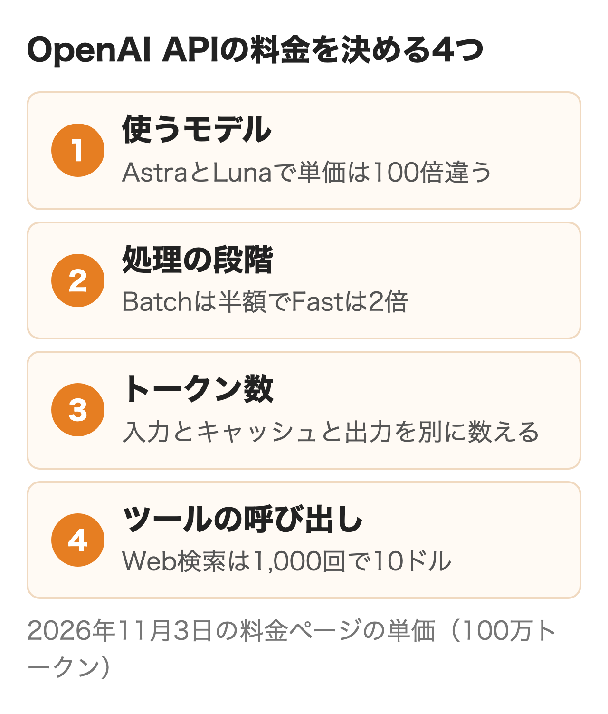
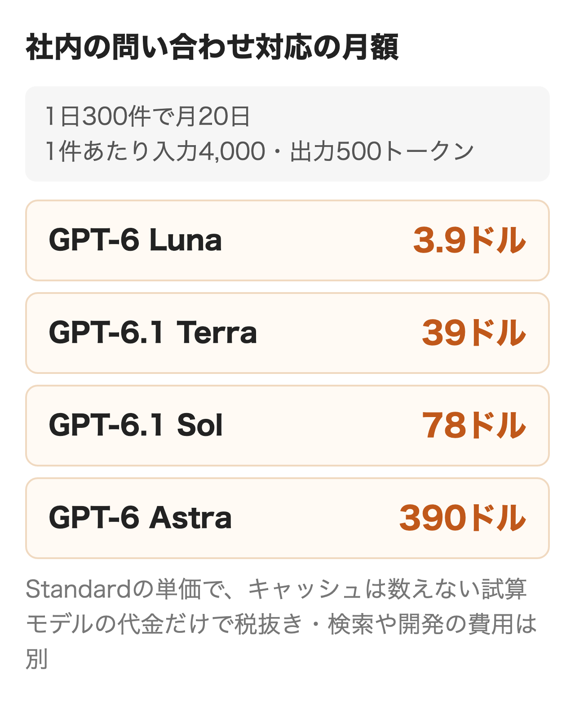
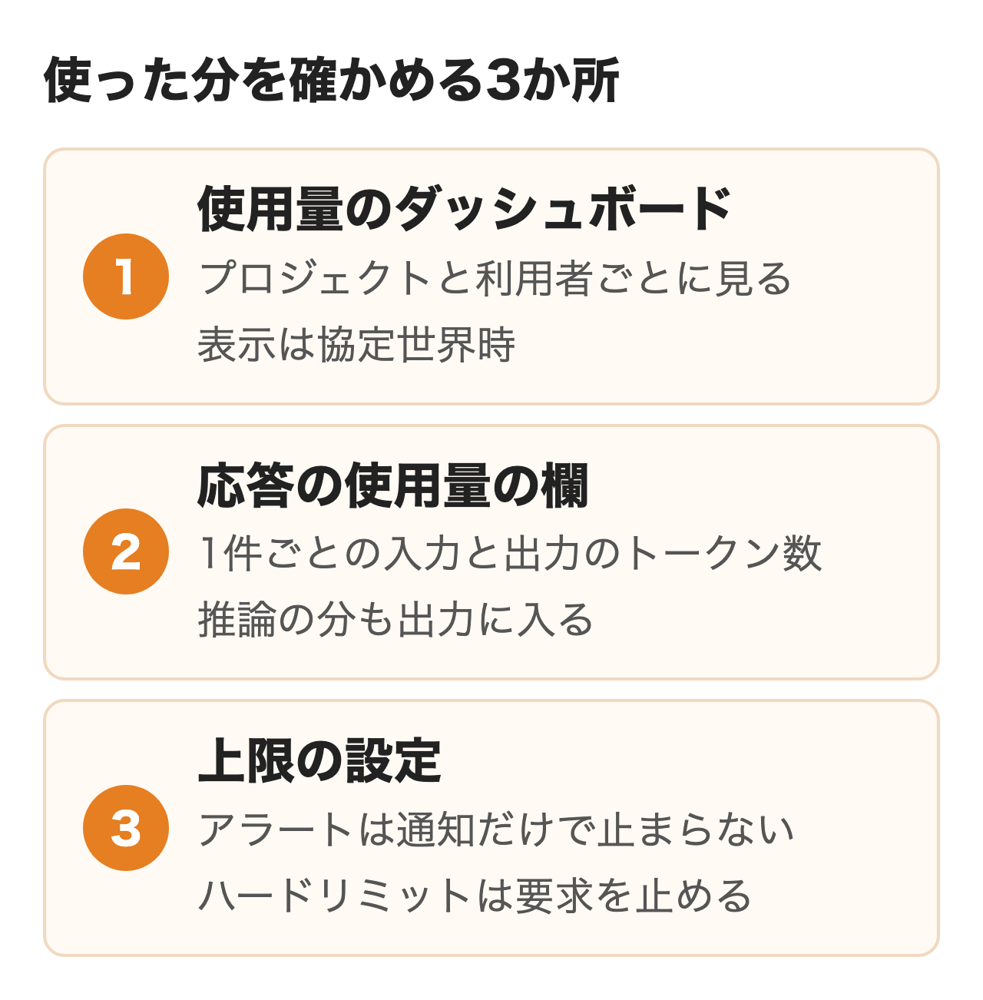

2026年11月3日のOpenAIの料金ページでは、社内の仕組みに組み込む候補になるGPT-6.1 Terraが100万トークンあたり入力1ドル・出力5ドル、GPT-6系で最も安いGPT-6 Lunaが入力0.1ドル・出力0.5ドルです。

社内の問い合わせ対応や文書の要約にOpenAIのAPIを使うよう言われ、月にいくらかかるか、どう払い、使った分をどこで確かめるかを説明する必要がある情シス・DX担当の方に向けて、単価と課金の型、自社の数字で置き換えられる月額の計算例、支払いと上限の設定をまとめました。

:::takeaways
- 料金は**モデル・処理の速さの段階・入力と出力のトークン数・ツールの呼び出し**で決まり、定額は無い
- 1日300件の社内の問い合わせ対応なら、GPT-6.1 Terraで**モデルの代金は月約39ドル**の試算（通常の単価。キャッシュの設定で約31〜45ドル）。急がない一括処理はBatchで半額になる
- 支払いは前払いのクレジットで、購入から1年で失効する。**使いすぎはハードリミットで止められる**が、反映は即時ではない
:::

## OpenAI APIの料金が決まる仕組み

見積もりを頼まれて料金ページを開くと、モデルの名前と米ドルの単価が何十行も並んでいて、月の金額がすぐには出ません。料金を決める要素を先に4つに分けておくと、表の行を迷わず読み解けます。

**OpenAI APIに月額の定額や初期費用は無く、使ったトークンの分だけ払う従量課金です。** トークンは文章を区切った単位で、送る指示文・会話の履歴・参照させる資料が入力、返ってくる答えが出力として別々に数えられます。GPT-6系の出力の単価は入力の5倍のため、長い答えを返す使い方ほど費用が膨らむ作りです。

<figure class="post-figure"></figure>

日本語が何トークンになるかの比率は、料金ページにもトークンの数え方の説明にも載っていません。英語はおおむね1トークン4文字とされますが、日本語の資料を渡す場合は、実際の文章をOpenAIのTokenizerに貼るか、試しに送った応答に返ってくる使用量の欄で数えるのが確実です。**推論するモデルは答えの前に見えない推論のトークンを作り、これも出力として課金されます。** 画面に出た答えが短くても、出力のトークン数は多く記録されることがあります。

Responses APIやChat Completions APIなど、呼び出すAPIの種類ごとの別料金はありません。どのAPIで呼んでも、選んだモデルの入力と出力の単価で数えられます。

## ChatGPTの料金プランとの違い

よく混同されるのが、社員が画面で使うChatGPTの月額とAPIの料金です。

| 比べる点 | ChatGPT Business | ChatGPT Enterprise | OpenAI API |
|---|---|---|---|
| 払い方 | 1人あたりの月額 | 個別の見積もり | 使ったトークン |
| 金額 | スタンダード3,050円から（年額課金） | 営業に問い合わせ | モデルごとの単価 |
| 使う形 | ChatGPTの画面 | ChatGPTの画面 | 自社の仕組みに組み込む |
| 対象 | 2〜200名 | 大規模な組織 | 制限なし |

Businessのスタンダードは年額課金で1人月20ドル（3,050円から）、月額課金で25ドル、プレミアムは年額課金で15,250円からです（OpenAIのビジネス向け料金ページ、2026年11月3日）。Enterpriseはクレジット制とトークン制の料金を選べます。

**ChatGPTの月額にAPIの利用料は含まれず、APIは別の請求です。** ただしOpenAIの開発者向けの案内によると、条件を満たすProとBusinessの契約者は、毎月のAPIクレジットを受け取れます。Businessはスタンダード1人分ごとに月20ドル、プレミアム1人分ごとに100ドルで、ワークスペース全体で月500ドルが上限です。受け取るには7日以上続いている有料の契約（無料の試用は対象外）と、ChatGPTの契約とAPIの組織の両方のオーナーであること、両方で同じメールアドレスを使っていることが要り、Plus・Go・Free・Enterpriseは対象外です。使い残しは請求期間の終わりに失効して繰り越せず、年額で前払いしているBusinessには1年分がまとめて付与され（年6,000ドルまで）、年の請求期間の終わりに失効します。

**すでにBusinessを契約している会社なら、試作の段階のAPIの代金はこのクレジットで賄える可能性があります。** 特典の内容は変わることがあるため、使う前に管理画面の請求の設定で受け取れる額を確かめておくのがおすすめです。

## モデル別のOpenAI API料金

OpenAIの料金ページの、通常の処理（Standard）の単価です。金額は100万トークンあたりの米ドルで、入力が27万2,000トークン以下の要求の値です。

| モデル | 入力 | キャッシュ入力 | 出力 | 向く使い方 |
|---|---|---|---|---|
| GPT-6 Astra | 10ドル | 1ドル | 50ドル | 画面の操作まで任せる処理 |
| GPT-6.1 Sol | 2ドル | 0.1ドル | 10ドル | 込み入った判断・コード |
| GPT-6.1 Terra | 1ドル | 0.05ドル | 5ドル | 社内の問い合わせ・要約 |
| GPT-6 Luna | 0.1ドル | 0.01ドル | 0.5ドル | 分類・抽出・大量処理 |
| GPT-5.4 mini | 0.75ドル | 0.075ドル | 4.5ドル | 前の世代の軽いモデル |
| GPT-5 nano | 0.05ドル | 0.005ドル | 0.4ドル | 短い文の仕分け |

**いちばん高いAstraと安いLunaでは、同じ量でも100倍の差があります。** 社内の質問に答える程度ならTerraかLunaで答えの質を試し、足りない種類の質問だけSolに上げるのが費用の面では合理的です。

### 長い入力とGPT-5.6系の単価

1回の入力が27万2,000トークンを超えると、GPT-6系は入力の単価が2倍、出力が1.5倍になります。Terraなら入力2ドル・出力7.5ドルです。社内規程を丸ごと毎回渡すような作りにすると、気づかないうちに高い側の単価に入ります。

ひとつ前のGPT-5.6系は、Solが入力4ドル・出力20ドル、Terraが2ドル・12ドル、Lunaが0.2ドル・1.2ドルです。**GPT-5.6 Solの単価は販促の価格で、料金ページには少なくとも2026年11月21日まで適用すると書かれています。** 期限の後の値は料金ページに載っていないため、Solで見積もる場合は採用の直前に取り直してください。

### 音声と画像の単価

声で受け答えするRealtime APIのgpt-realtime-2.1は、音声の入力が100万トークンあたり32ドル、出力が64ドルで、テキストの入出力は4ドルと24ドルです。安いgpt-realtime-2.1-miniは音声の入力10ドル・出力20ドルです。音声の会話を扱うGPT-Live 1は1分0.05ドルで、秒単位で数えられ、裏で使うモデルとツールの代金は別にかかります。

文字起こしのgpt-transcribeは1分0.0045ドル、画像を作るgpt-image-2.5は画像の入力8ドル・出力30ドルです。電話の自動応答のように音声を扱う仕組みは、テキストだけの仕組みより1件あたりの単価が1桁上がる点に注意が要ります。

## 処理の速さで変わる課金の型

同じモデルでも、答えを返す速さの段階で単価が変わります。リクエストの`service_tier`の指定で選び、指定しなければStandardです。

| 段階 | 単価 | 速さと条件 | 向く処理 |
|---|---|---|---|
| Standard | 基準 | 通常 | 社内チャット・問い合わせ対応 |
| Batch | 半額 | 24時間以内に返す | 夜間の一括の要約や分類 |
| Flex | 半額（Batchと同じ） | 遅く処理できない時間がある（ベータ） | 評価・データの整理 |
| Fast | 2倍 | 最大2.5倍速く応答が安定 | 顧客向けで待たせたくない画面 |
| Ultrafast | 6倍 | さらに速い（GPT-6 AstraとGPT-6.1 Solのみ） | 速さが売上に直結する処理 |

Batchは要求をまとめたファイルを送り、24時間以内に結果を受け取る方式で、通常とは別の大きい処理枠が使えます。Flexは普通の呼び出しのまま安くなる代わりに、応答が遅れたり資源が足りず断られたりすることがあり、使えるモデルが限られます。Fastは2026年7月30日にPriority processingから名前が変わった段階です。

**社員が画面で待つ処理はStandard、翌朝まででよい処理はBatchに分けるだけで、まとめて流す分の代金は半分になります。** Fastは顧客が使う画面で応答の速さを揃えたいときに検討する段階で、社内向けの仕組みで最初から選ぶ必要はありません。

### キャッシュ入力

前と同じ指示文や資料を先頭に付けて送ると、一致した部分がキャッシュから読まれ、安い単価になります。GPT-6.1 SolとTerraの読み取りは通常の入力の0.05倍、ほかのGPT-5.6以降の多くのモデルは0.1倍です。GPT-5.6以降はキャッシュに書き込む分にも単価があり、既定の30分の保持なら入力の1.25倍、Responses APIで選べる12時間の保持なら2.5倍です。

GPT-5.6以降でキャッシュされるのは1,024トークン以上の前置きです。**既定の設定では区切りが最後の質問の後ろに置かれるため、質問が毎回変わる使い方だと前置きは使い回されず、毎回の入力が書き込みの単価で数えられます。** 指示文と社内資料を毎回同じ順で先頭に置き、その直後に区切りを明示して（explicit）、質問を最後に付ける作りにすると、前置きがキャッシュから読まれます。

### ツールの料金

モデルにWeb検索やファイル検索をさせると、トークンとは別に呼び出しの料金がかかります。

| ツール | 料金 | 注意点 |
|---|---|---|
| Web検索 | 1,000回で10ドル | 検索結果を読んだトークンも入力として課金 |
| ファイル検索の呼び出し | 1,000回で2.5ドル | Responses APIでの料金 |
| ファイル検索の保存 | 1GBにつき1日0.1ドル | 最初の1GBは無料 |
| コンテナ（コード実行など） | 1GBで20分0.03ドル | 分単位・1回は最低5分 |

文章をベクトルに変える埋め込みはtext-embedding-3-smallが100万トークンあたり0.02ドル、3-largeが0.13ドル、不適切な内容を判定するモデレーションは無料です。

## 社内の問い合わせ対応の月額

社員から総務や情シスへの問い合わせに、社内の規程を参照してAPIが答える仕組みを想定して、モデルの代金を数えます。前提は次のとおりで、自社の件数とトークン数に置き換えれば同じ式で出せます。

| 前提 | 値 | 置き換える所 |
|---|---|---|
| 1日の件数 | 300件 | 社員数×1人あたりの件数 |
| 月の営業日 | 20日 | 自社の営業日 |
| 1件の入力 | 4,000トークン（指示文1,500＋規程の抜粋2,000＋質問と履歴500） | 渡す資料の長さ |
| 1件の出力 | 500トークン | 答えの長さ |
| 段階 | Standard・短い入力 | 待てる処理はBatch |

この前提で月の入力は300件×20日×4,000で2,400万トークン、出力は300万トークンです。式は「月の入力トークン÷100万×入力の単価＋月の出力トークン÷100万×出力の単価」で、キャッシュの書き込みと読み取りは数えず、入力はすべて通常の単価で数えています。円は三菱UFJ銀行の2026年11月2日の公表仲値（1ドル157.80円）で換算し、消費税10%を足した額も並べました。

| モデル | 入力の代金 | 出力の代金 | 月額（ドル） | 円・税込の目安 |
|---|---|---|---|---|
| GPT-6 Luna | 2.4ドル | 1.5ドル | 3.9ドル | 約680円 |
| GPT-6.1 Terra | 24ドル | 15ドル | 39ドル | 約6,800円 |
| GPT-6.1 Sol | 48ドル | 30ドル | 78ドル | 約1万3,500円 |
| GPT-6 Astra | 240ドル | 150ドル | 390ドル | 約6万7,700円 |

<figure class="post-figure"></figure>

**この規模なら、Terraで組んでもモデルの代金は月50ドルに届きません。** ただしGPT-5.6以降のモデルを既定の設定のまま使うと、毎回の入力が書き込みの単価（1.25倍）で数えられ、Terraは月約45ドル（約7,800円）になります。指示文の直後に区切りを明示して1,500トークンを使い回すと、月約31ドルまで下がる試算です（1日20回書き込む前提）。反対に、資料の抜粋を毎回1万トークン渡す作りにすると、通常の単価でもTerraの月額は約87ドルになります。**月額を動かすのは件数より、1件で渡す資料の長さです。**

件数を10倍の1日3,000件に広げると、Terraで通常の単価なら月約390ドル、既定のキャッシュの設定のままなら約450ドルです。後で説明する利用ティアの最初の段階は月の上限が500ドルで、ほぼ上限に届きます。累計の購入額が100ドルに達すると次の段階（月5,000ドル）に自動で上がるため、全社に広げる前に今の段階を確かめておきます。

### 夜間の一括処理はBatchで半額

日中に届いた問い合わせの記録を、夜のうちに分類して要約する処理も数えておきます。1日2,000件、1件の入力2,000トークン・出力200トークンで30日動かすと、月の入力は1億2,000万トークン、出力は1,200万トークンです。

| モデル | Standard | Batch |
|---|---|---|
| GPT-6 Luna | 18ドル | 9ドル |
| GPT-6.1 Terra | 180ドル | 90ドル |

結果が翌朝そろえばよい処理なので、Batchに回すだけでTerraなら月90ドル下がります。分類のような決まった作業はLunaで質が足りるかを先に試すと、さらに1桁下げられます。

### モデル以外にかかる費用

上の金額はモデルの代金だけです。社内の文書をOpenAIのファイル検索に置いて探させる場合、5GBの文書なら保存で月約12ドル、月6,000回の検索の呼び出しで15ドルが加わります。自前の検索の部品を使うなら、その部品とサーバーの費用が別にかかります。部品ごとの費用の考え方は[RAG構築の費用](/media/rag-build/)にあります。

OpenAIの画面でエージェントの流れを組むAgent Builderも、課金はここで見たモデルとツールの代金だけです。2026年11月30日に終了する予定で、移し先は[OpenAI Agent Builderとは](/media/openai-agent-builder/)にまとめました。

規模の大きい仕組みほど、画面や社内システムとのつなぎ込みを作る開発費と保守の費用がモデルの代金を上回りがちです。APIの代金と開発費を分けて見積もりに示しておくと、毎月かかる額が稟議で伝わりやすくなります。

## 支払いとクレジットの仕組み

**新しく作ったAPIの組織は前払いで、先にクレジットを買い、使った分が残高から引かれます。** OpenAIのヘルプによると、最初の購入は最低5ドル・既定10ドルです。

| 項目 | 内容 |
|---|---|
| 購入の単位 | 最低5ドル（既定10ドル） |
| 有効期限 | 購入から1年で失効・延長できない |
| 返金 | 原則できない（請求の誤りや不正利用などの例外あり） |
| 自動リチャージ | 設定時は既定でオン。しきい値と月の上限を決められる |
| 残高が尽きたとき | `credit_balance_exhausted`のエラーで止まる |
| 消費税 | 2025年1月1日から10%が加わる |

残高が決めた額を下回ると自動で買い足す自動リチャージは、最初の設定画面で既定でオンになっています。月のリチャージ上限は自動で買う額の上限で、使う量の上限ではありません。**会社のカードで払うなら、自動リチャージを切るか月の上限を決めてから最初の購入を確定するのがおすすめです。**

残高が尽きても、APIがすぐに止まるとは限りません。止まるまでに処理された分はマイナスの残高として記録され、次の購入から差し引かれます。前払いの残高を支出をすぐ止める上限として当てにしないよう、ヘルプにも書かれています。

料金は米ドルで表示され、日本の利用者にはOpenAI OpCo, LLCが10%の消費税を加えて請求します。発行される適格請求書には税額が円で記載され、登録番号はT3700150133253です。Enterpriseのような個別の契約で買う法人には、一般的にリバースチャージの仕組みが適用されるため請求書に消費税は加わらず、受け取る側の会社が税額を自ら計算して申告・納付します。

### 利用ティアと月の上限

OpenAIは組織ごとに、累計の購入額に応じて利用ティアを決め、月に使える上限を割り当てています。

| ティア | 条件（累計の購入額） | 月の利用上限 |
|---|---|---|
| Build | 5ドル | 500ドル |
| Launch | 100ドル | 5,000ドル |
| Grow | 500ドル | 20万ドル |

ティアは購入額が条件に届くと自動で上がり、1分あたりの要求数とトークン数の上限も上がります。Buildの上限はTerraが1分5,000回・100万トークン、Lunaが1分5,000回・200万トークンです。**本番の前に、見込みの月額と朝の始業直後のような混む時間の量が、今のティアに収まるかを比べておきます。** 上限は組織とプロジェクトの単位でかかり、社員1人ずつではありません。

## 使用量の確認と上限の設定

使った分を確かめる場所は使用量のダッシュボード・応答の使用量の欄・上限の設定の3つです。

<figure class="post-figure"></figure>

### 使用量のダッシュボード

API Platformの使用量のダッシュボードは、組織のオーナーか、使用量を見る権限を持つ人が開けます。**表示は協定世界時（UTC）なので、日本時間の社内の記録と比べるときは9時間のずれに注意が要ります。** プロジェクトの絞り込みは画面の他の場所とは別にあり、何も選ばなければ組織の全体が出ます。Responses APIとChat Completions APIの分なら、利用者ごとの絞り込みも可能です。

書き出しの期間に制限は無く、月の請求と突き合わせる明細も出せます。ひとつのAPIキーを複数のアプリで使い回すと、ダッシュボードの合計からはどのアプリの分かを区別できません。**部門やアプリごとにプロジェクトを分け、キーもプロジェクトごとに発行しておくと、代金を部門に割り振れます。** 開発者が試しに使うPlaygroundの分も、APIの使用量に含まれる点は見落としがちです。

### 1件ごとの使用量

APIの応答にはその要求で使ったトークン数が付いてきます。Responses APIなら`usage.input_tokens`と`usage.output_tokens`で、モデルによってはキャッシュから読んだ分と推論の分の内訳も入るため、答えの長さと代金が合わない理由もここで分かります。この数を自社の記録に残しておけば、部門別や機能別の代金を自分で集計でき、ダッシュボードの数字との照合にも使えます。

### アラートとハードリミット

上限を決められる場所は組織全体とプロジェクトごとの2か所です。

| 種類 | 設定額に達すると | 向く使い方 |
|---|---|---|
| アラート | 通知が届く。APIは止まらない | 使いすぎに早く気づく |
| ハードリミット | 対象の要求が429のエラーになる | 月の予算を超えさせない |

組織の上限はOrganization limitsのSpendから「Edit spend limit」を選び、月の上限額を入れて「Enforce a hard limit」をオンにして保存します。プロジェクトの上限もProject settingsのLimitsにある同じ項目からで、手順は変わりません。上限に達すると、組織なら`organization_spend_limit_exceeded`、プロジェクトなら`project_spend_limit_exceeded`のエラーで要求が断られます。

**反映は即時ではないため、記録上の代金が設定額をわずかに超えることがあります。** ハードリミットは本番の利用も止めるので、手前の額にアラートを置き、通知を受けたら上限を上げるか原因を調べる流れを決めておくのがおすすめです。上限は月が替わると元に戻ります。キーが外に漏れたときの被害も、プロジェクトごとの上限があれば、そのプロジェクトの額までに抑えられます。

## Azure OpenAIやGemini APIと比べる観点

同じOpenAIのモデルは、MicrosoftのAzure OpenAIからも使えます。2026年11月2日に比べたGPT-6系の通常の単価は、Azureのグローバル標準と同じでした。

| 比べる点 | OpenAI API | Azure OpenAI |
|---|---|---|
| 請求 | OpenAIへ米ドルで前払い | Azureの請求にまとまる |
| 単価 | 基準 | GPT-6系はグローバル標準で同じ |
| 予算で止める上限 | ハードリミットがある | 無い（アラートを自分で組む） |
| 処理する場所 | 2026年3月5日以降のモデルは、データ所在地の指定で10%上乗せ | データゾーン・リージョンを選ぶ |
| 権限の管理 | OpenAIの組織とプロジェクト | Entra IDやAzureの権限 |

**単価で差がつかない以上、選ぶ理由は請求と管理の側にあります。** すでにAzureで社員のアカウントと請求を管理している会社にはAzureが向き、月の上限で確実に止めたい会社や、新しいモデルをすぐ試したい会社にはOpenAIのAPIが向いています。Azureの料金の詳細は[Azure OpenAIの料金](/media/azure-openai-pricing/)が扱う範囲です。

データを処理する場所を指定する場合、OpenAIのAPIは2026年3月5日以降に出たモデルで10%上乗せになります。日本の地域を選べるのは保存の場所で、OpenAIのデータの扱いのページでは、処理の地域に日本は入っていません。米国以外の地域を使うには営業への相談と追加の承認が要ります。2023年3月1日以降、APIに送ったデータはオプトインしない限りモデルの学習に使われません。

GoogleのGemini APIなど他社のAPIと比べるときも、単価の表だけでなく、無料で試せる範囲・請求の窓口・月の上限で止められるか・処理する場所の4つを並べると、社内の稟議で聞かれる点を先に埋められます。

社内のAIをAPIでどこまで組むか、どのモデルと段階で始めるかを決めきれない場合は、nitoの[AIエージェント構築支援](/ai-agent/)で要件の整理から相談できます。

## まとめ

- **まず試す段階なら**、5ドルのクレジットでTerraとLunaに同じ質問を送り、答えの質と1件あたりのトークン数を測る。Businessを契約していれば、APIクレジットの特典を先に確かめる
- **社内に配る段階なら**、件数×1件のトークン数で月額を出し、ティアの月の上限に収まるかを見る。プロジェクトを部門ごとに分け、ハードリミットとアラートを置いてから公開する
- **待てる処理が多いなら**、Batchに回して半額にする。月額が膨らむときは件数より渡す資料の長さを先に見直す

## よくある質問

### OpenAI APIは1回いくらかかりますか？

1回の代金は決まっておらず、送ったトークン数と返ってきたトークン数にモデルの単価を掛けて決まります。GPT-6.1 Terraで入力4,000トークン・出力500トークンなら通常の入力の単価で1回0.0065ドルで、1ドル157.80円なら約1円です（税抜き）。

### OpenAI APIに無料枠はありますか？

新規の利用者に一律で付く無料枠は、OpenAIのヘルプには書かれていません。新しいAPIの組織は前払いで、最低5ドルのクレジットを買って始めます。ChatGPTのProかBusinessを契約していれば、条件を満たすと毎月のAPIクレジットを受け取れます。

### OpenAI APIはChatGPT Plusで使えますか？

含まれません。ChatGPTの月額とAPIは別の請求で、Plusの契約者はAPIクレジットの特典の対象でもありません。

### OpenAI APIの料金は円で払えますか？

料金とクレジットは米ドルで表示されます。日本の利用者には10%の消費税が加わり、適格請求書には税額が円で記載されます。

### OpenAI APIのクレジットに有効期限はありますか？

購入したクレジットは1年で失効し、延長はできません。ChatGPTの契約で受け取るAPIクレジットは、その請求期間の終わりで失効します。

### OpenAI APIの使いすぎを止められますか？

組織かプロジェクトにハードリミットを設定すると、上限に達した後の要求は429のエラーになります。反映は即時ではないため、記録上の代金が設定額を少し超えることがあります。

## 出典

- OpenAI「[Pricing](https://developers.openai.com/api/docs/pricing)」（2026年11月3日取得）
- OpenAI「[ビジネス向け料金](https://openai.com/ja-JP/business/pricing/)」（同）
- OpenAI「[API credits for ChatGPT subscribers](https://developers.openai.com/api/docs/guides/chatgpt-api-credits)」（同）
- OpenAI「[Rate limits](https://developers.openai.com/api/docs/guides/rate-limits)」（同）
- OpenAI「[Spend limits](https://developers.openai.com/api/docs/guides/spend-limits)」（同）
- OpenAI「[Batch API](https://developers.openai.com/api/docs/guides/batch)」（同）
- OpenAI「[Flex processing](https://developers.openai.com/api/docs/guides/flex-processing)」（同）
- OpenAI「[Fast mode](https://developers.openai.com/api/docs/guides/fast-mode)」（同）
- OpenAI「[Prompt caching](https://developers.openai.com/api/docs/guides/prompt-caching)」（同）
- OpenAI「[Reasoning models](https://developers.openai.com/api/docs/guides/reasoning)」（同）
- OpenAI「[Your data](https://developers.openai.com/api/docs/guides/your-data)」（同）
- OpenAI ヘルプセンター「[API のプリペイド請求の設定と管理](https://help.openai.com/ja-jp/articles/8264644-how-can-i-set-up-prepaid-billing)」（同）
- OpenAI Help Center「[Reviewing API usage and costs](https://help.openai.com/en/articles/10478918-api-usage-dashboard)」（同）
- OpenAI ヘルプセンター「[OpenAI の請求書における日本の消費税](https://help.openai.com/ja-jp/articles/10242647-the-japanese-consumption-tax-on-your-openai-invoices)」（同）
- 三菱UFJリサーチ&コンサルティング「[2026年11月2日の為替相場](https://www.murc-kawasesouba.jp/fx/past/index.php?id=261102)」（同）
