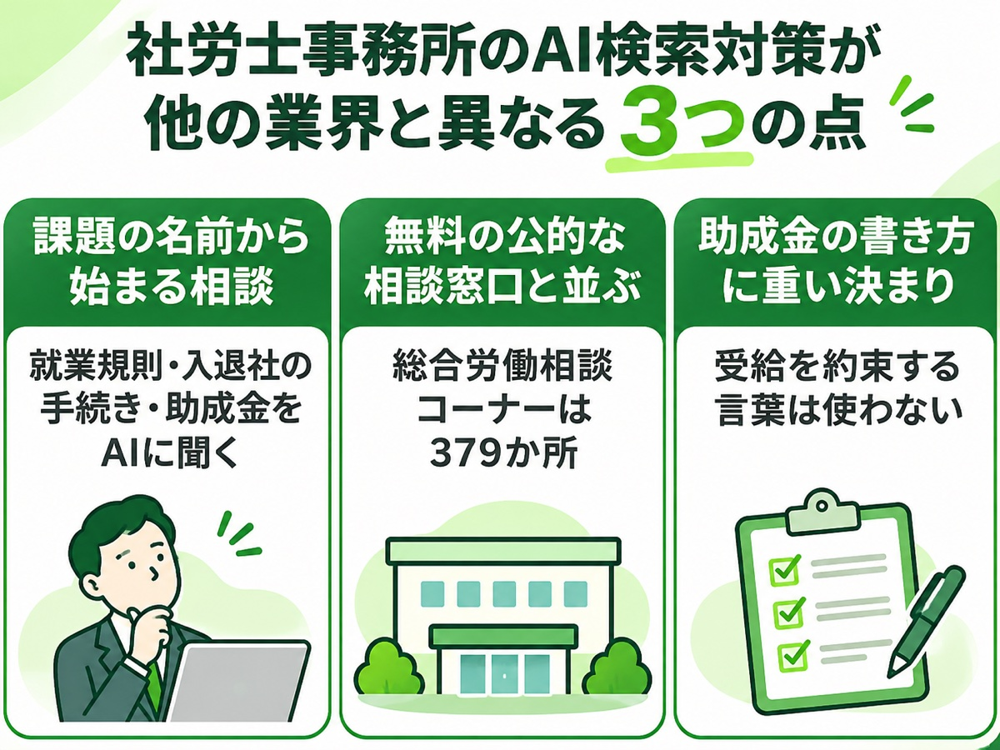
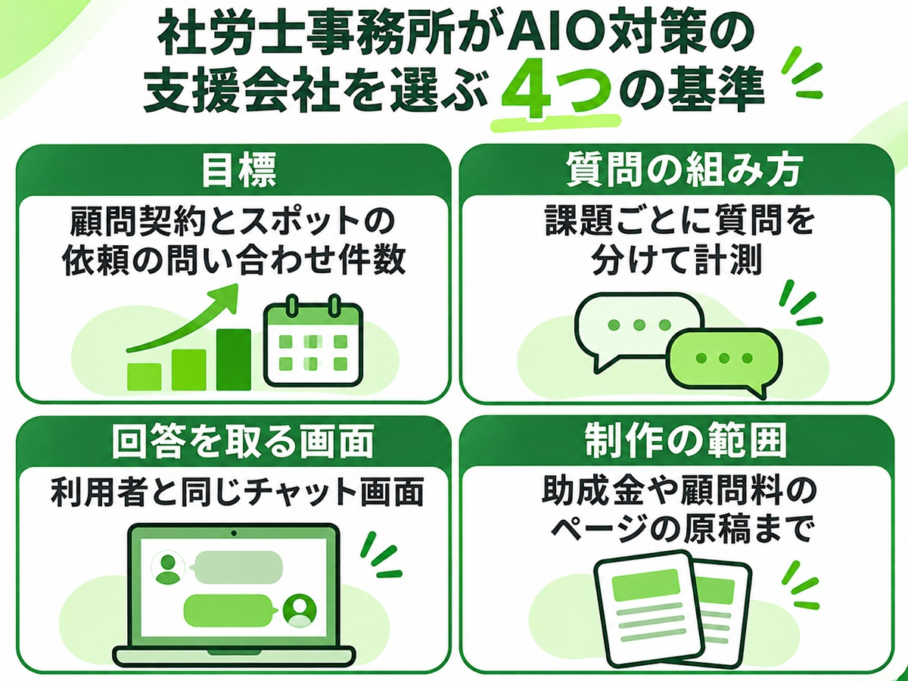

社労士事務所がAIO対策（AI検索対策）を外部に依頼するなら、**顧問契約とスポットの依頼の問い合わせ件数を目標に置き、就業規則・手続き・助成金のような課題ごとの質問で計測して記事まで作る会社**が向いています。顧問先を広げたい事務所や、増やしたい業務がはっきりしている事務所に合う選び方です。

この記事は株式会社nitoが書いているため、自社を1番目に載せました。ほかの6社は各社の公式サイトで読み取れる範囲から、どんな社労士事務所に合うかで整理しています。

:::takeaways
- 経営者や人事は、**社労士という言葉より先に就業規則・入退社の手続き・助成金のような課題の名前から**AIに聞くことがある
- 職場のトラブルには**労働局や社労士会の無料の相談窓口もある**ため、計測する質問は顧問や手続きの依頼に近いものを中心に組む
- 助成金のページは**要件・時期・受け取れない場合を書き、受給を約束しない**。不正受給には全額の返還や5年間の不支給などの措置がある
- 目標に置くのはAIでの言及率ではなく、**顧問契約とスポットの依頼の問い合わせ件数**
- 支援会社は**目標・課題ごとの質問・回答を取る画面・制作の範囲**の4つで比べる
:::

## 社労士事務所のAI検索対策が他の業界と違う点は？

顧問先候補の相談の始まり方・無料の公的な窓口の多さ・助成金の扱いの3つで、社労士事務所は他の業界と異なります。**3つを自分の事務所に当てはめておくことが、支援会社の提案を見る前の準備です。**

<figure class="post-figure post-figure--zu"></figure>

### 課題の名前から始まる相談

社労士にまだ依頼したことのない経営者は、事務所を探す前に困りごとそのものをAIに聞くことがあります。全国社会保険労務士会連合会は社労士の主な業務として、入退社の手続きや給与計算などの労働社会保険の手続き、就業規則の作成や見直しを含む労務管理の相談指導、労働紛争のあっせんの代理などを挙げています。経営者の側から見ると、どれも社労士という資格の名前より先に課題の名前で浮かぶ用事です。

| 課題 | 相談のきっかけの例 | AIへの聞き方の例 |
|---|---|---|
| 入退社・産休育休の手続き | 初めて人を雇う・従業員の出産 | 従業員が産休に入るときの手続きは？ |
| 就業規則 | 常時10人以上になる・規程が古いまま | 従業員が10人を超えたら就業規則は必要？ |
| 給与計算 | 担当者の退職・手続きの負担 | 給与計算を外部に委託するといくらかかる？ |
| 助成金 | 賃上げや正社員化を考えている | パートを正社員にすると使える助成金は？ |
| 労務トラブル | 未払い残業代の請求・社員の退職問題 | 辞めた社員から残業代を請求されたらどうする？ |

常時10人以上の従業員を使う会社に就業規則の作成と労働基準監督署への届出を求めているのは、労働基準法第89条です。**計測する質問も、地域と社労士の組み合わせだけでなく課題と事情を添えた形を入れておくと、顧問先候補が実際に見る回答に近い見え方を追えます。**

### 無料の公的な相談窓口と並ぶ

職場のトラブルには公的な相談窓口が多くあります。厚生労働省によると、都道府県労働局などの総合労働相談コーナーは379か所に置かれ（2025年4月1日現在）、令和6年度の総合労働相談件数は120万1,881件で5年連続120万件を超えました。各都道府県の社労士会も総合労働相談所を設け、社員からの未払い残業代の請求や退職問題といった経営者の相談に無料で応じています。

労務トラブルの相談先を探す経営者には、こうした無料の窓口も選択肢に入ります。公的な窓口は目の前のトラブルを相談する場で、毎月の手続きや規程の見直しを継続して任せる顧問とは役割が異なります。**事務所が狙う質問は顧問を頼む・手続きを任せる・規程を見直すといった、継続して依頼する場面を中心に組むのがおすすめです。**

### 助成金の書き方に重い決まりがある

助成金は経営者の関心が高い一方で、書き方を誤ると事務所の信用に関わるテーマです。厚生労働省は雇用関係助成金の不正受給について、全額の返還に加えて延滞金と不正受給額の2割に相当する額の納付を求め、不正受給の決定日から5年間は支給しないとしています。不正受給に関与した社労士や代理人も、事業主と連帯して返還する義務を負い、氏名や事業所名が公表されます。

**助成金のページには対象の要件・計画や申請の時期・受け取れない場合を書き、「必ずもらえる」のような受給を約束する言葉は使わないのが前提です。** 社会保険労務士法施行規則第12条の11第2項は、社労士の業務の広告で、著しく事実に相違する表示や、実際より著しく優良または有利だと誤認させる表示を禁じています。支援会社がこの前提を知ったうえで原稿を書けるかは、契約前に聞いておきたい点の1つです。

## 支援会社はどう選べばいい？

社労士事務所が支援会社を選ぶときは、目標・質問の組み方・回答を取る画面・制作の範囲の4つを最初の打ち合わせで聞くと、各社の違いが見えてきます。

<figure class="post-figure post-figure--zu"></figure>

| 基準 | 確認する質問 | 社労士事務所で重要な理由 |
|---|---|---|
| 目標 | 何の件数を増やすことを目標にしますか？ | 顧問契約とスポットの依頼では1件の重みが異なり、分けて数えないと費用に見合うか判断しにくい |
| 質問の組み方 | 課題ごとに質問を分けて計測しますか？ | 課題によって聞く人も添える事情も変わりやすい |
| 回答を取る画面 | 回答は利用者と同じチャット画面から取得していますか？ | プログラム用の窓口（API）の回答とは出典が異なることが多い |
| 制作の範囲 | 助成金や顧問料のページの原稿まで書きますか？ | 要件と時期の書き方を誤ると事務所の信用に関わる |

### 顧問契約の問い合わせを目標に置くか

言及率は途中の目印として役に立つものの、それだけで顧問先は増えません。制度を調べる質問で事務所の名前が挙がっても、聞いた人が自社で手続きを済ませれば依頼にはならないためです。

**どの課題のどの質問で名前が挙がれば顧問契約やスポットの依頼につながるかを先に決め、問い合わせのフォームで依頼の種類と何で知ったかまで数える会社**なら、費用に見合うかを契約の件数で判断できます。

### 課題ごとに質問を組むか

地域名と社労士の組み合わせに絞った計測では、課題から聞き始める経営者にどう見えているかが分かりません。就業規則・入退社の手続き・給与計算・助成金・労務トラブルに分け、従業員数や業種などの事情を1つずつ変えた質問を組むと、どの事情で他の事務所に替わるかが見えてきます。

### 利用者と同じ画面で計測するか

回答の集め方にはプログラム用の窓口（API）から取得する方法と、利用者が使うチャット画面に質問して取得する方法があります。2026年9月に公開された論文では、ChatGPTのAPIとチャット画面に同じ質問をしたとき、示された出典の重なりは平均12.0%でした。経営者や人事の担当者が実際に目にする回答で計測しているかは、レポートの数字を信頼できるかを左右します。

### 助成金や顧問料の原稿まで書けるか

AIの回答の材料になるのは、事務所のページに書かれた事実です。社労士事務所なら、顧問契約に含まれる手続きと相談の範囲・顧問料が変わる条件・扱う助成金の要件と時期・就業規則の作成から届出までの流れが候補になります。

提案が分析のレポートまでなのか、原稿の作成と公開後の修正まで含むのかは、契約前に確認しておきたい点です。**原稿を事務所の社労士が公開前に確認する流れまで組めるか**も聞いておくと、公開が止まりにくくなります。

## この記事での選定基準

AI検索対策（AIO・LLMO・GEO）を独立したサービスとして公式サイトに出している会社のうち、AIO対策会社の比較・一覧記事によく挙がる6社を選びました。書き手のnitoは1番目に置いています。

紹介は各社の公式サイトで読み取れる範囲と、どんな社労士事務所に合うかでまとめています。料金や契約の条件は各社の最新の案内で確認してください。

:::linkcard
url: /media/shigyo-ai-search/
title: 士業のためのAI検索対策。AIに選ばれる事務所になる方法とは
desc: 士業の事務所が自ら進めるAI検索対策の考え方と具体策を解説しています。
:::

## 社労士事務所におすすめのAIO対策会社7社の比較

強みと、どんな社労士事務所に向いているかで7社を並べました。

| 会社 | 強み | 向いている社労士事務所 |
|---|---|---|
| 株式会社nito | 士業の支援実績。計測から記事の制作・公開後の運用まで一気通貫で | 顧問契約の問い合わせを増やしたい事務所 |
| ナイル株式会社 | SEOの長い支援実績とLLMOコンサルティング | 労務のコラムが多く、SEOとまとめて依頼したい事務所 |
| 株式会社LANY | SEOとLLMOをまとめたコンサルティングと記事制作 | 法改正や制度の解説記事を中長期で増やしたい事務所 |
| 株式会社Faber Company | ミエルカGEOなどのツールとGEO/LLMO支援 | 所内の担当者がツールで数字を確認したい事務所 |
| 株式会社ニュートラルワークス | 業界別のサービスとサイト改修までの一括対応 | ホームページの作り直しも検討している事務所 |
| 株式会社PLAN-B | SEOの土台づくり・LLMO/GEOエージェント・AI×業界の調査レポート | 依頼の前に業界の状況を調べたい事務所 |
| 株式会社ジオコード | SEO・Web制作・AI最適化を一社で | 制作とAI検索対策の窓口を1つにしたい事務所 |

料金はnitoを含めどの会社も、対策の範囲や制作の量で変わります。2〜3社から同じ条件で見積もりを取り、4つの基準への答えを並べて比べるのがおすすめです。

業種を問わず依頼先を広く比べたい場合や、費用の相場を知りたい場合は、AIO対策と同じ取り組みを指すLLMO対策の会社20社を比較表で並べた記事が参考になります。

:::linkcard
url: /media/llmo-companies/
title: LLMO対策の会社おすすめ20選・比較表と費用相場・選び方
desc: LLMO対策の会社20社を比較表で並べ、費用相場と選び方を解説しています。
:::

## 1. 株式会社nito

[株式会社nito](/llmo/)は、計測から分析、サイトの改善と記事の制作、公開後の運用までを一気通貫で支援するAI検索対策の会社です。何を書き、どこを直すかは、ChatGPTやGeminiなど主要なAIの実際の回答を毎晩読み、他社が選ばれている理由から決めます。士業の支援実績もあり、**追いかける数字はAIでの言及率ではなく、顧問契約やスポットの依頼の問い合わせ件数です。**

顧問契約は毎月の手続きや相談が続くため、1件の依頼が長い付き合いになりやすい業務です。そのため名前が挙がる質問をむやみに増やすより、顧問先候補が課題と事情を添えて聞いたときに理由つきで挙がる状態をつくることを優先します。

### 社労士事務所に合う理由

- **課題ごとに質問を組む。** 就業規則・入退社の手続き・給与計算・助成金・労務トラブルに分け、従業員数や業種の事情を添えた質問を設計する
- **実際のチャット画面で計測する。** 経営者や人事の担当者が見る回答のまま、回答本文と引用元を毎晩記録する。これまでに記録した回答は3万件を超える（2026年11月時点）
- **他の事務所が挙がる理由を回答本文から抜き出す。** AIが他の事務所を勧めるときに添えた理由のうち、自分の事務所にも当てはまるのにページに書いていないものを、新しく書く内容の候補にする
- **助成金と顧問契約の記事を作り、公開後も運用する。** 要件・時期・受け取れない場合を書いた助成金の記事や、顧問契約の範囲を説明する記事を作る。公開の判断は事務所の社労士に委ね、公開後は回答の変化を見て書き方を修正する
- **問い合わせまで数える。** フォームに依頼の種類・何で知ったか・AIに何を聞いたかの項目を入れ、AIで知った人からの依頼の件数まで追う

お客様にお願いするのはヒアリング・公開前の確認・実装の3点だけです。

### これまでの成果

| 支援先 | 成果 |
|---|---|
| SaaS企業 | 取り組み3ヶ月で、AIでの言及率が10%から45%に。AI経由のコンバージョンは5ヶ月で約6.7倍 |
| 士業 | AIでの言及率が0%から20%に。新しいページは公開3日でAIの回答の引用元に |

成果の出方は事業・体制・地域しだいです。どの質問でどこまで狙えるかは、無料の現状分析のあとにお伝えしています。

### こんな事務所に向いている

- 就業規則・手続き・助成金のうち、増やしたい依頼がはっきりしている社労士事務所
- 所内に記事を書く人がおらず、計測から原稿の作成まで窓口を1つにしたい事務所
- 言及率のレポートより、顧問契約の問い合わせ件数で効果を確認したい事務所

:::point
nitoでは顧問先候補が聞きそうな質問をChatGPTやGeminiなど主要なAIに実際に入力し、事務所の名前が挙がるか、どう紹介されるか、代わりにどの事務所が挙がるかをまとめた[現状分析レポート](/llmo/)を無料でお出ししています。
:::

## 2. ナイル株式会社

ナイル株式会社はSEOコンサルティングを長く手がけてきたマーケティング支援会社です。LLMO（AI検索対策）コンサルティングをSEOのサービスと並べて提供しており、検索とAIの両方の対策を1つの窓口で相談できます。

**労務や助成金のコラムをすでに多く公開していて、SEOで積み上げた記事をAI検索にも生かしたい社労士事務所**に向いています。

## 3. 株式会社LANY

株式会社LANYはSEOを軸にしたデジタルマーケティングの支援会社です。LLMOコンサルティングに加えて、SEO/LLMO向けの記事制作やLP制作も扱っています。

**法改正や制度の解説記事を中長期で増やし、記事の本数もまとめて任せたい事務所**に合います。

## 4. 株式会社Faber Company

株式会社Faber CompanyはSEOツール「ミエルカSEO」の提供元です。AI検索での見え方を確認するツール「ミエルカGEO」と、GEO/LLMO支援のコンサルティングを用意しています。

**所内にWebの担当者がいて、ツールで事務所の数字を見ながら改善を進めたい事務所**に向いています。

## 5. 株式会社ニュートラルワークス

株式会社ニュートラルワークスはWeb制作と集客支援を行う会社です。LLMO対策（AI検索最適化対策）を扱い、建設・不動産・クリニックなど業界別のAI検索最適化のサービスも出しています。Web制作の会社のため、サイトの改修まで同じ窓口で依頼できます。

**ホームページが古く、AI検索対策とあわせて作り直しも検討している事務所**に合います。

## 6. 株式会社PLAN-B

株式会社PLAN-BはSEOコンサルティングを長年手がけてきた会社です。2026年10月にはSEO実行支援ツール「SEARCH WRITE」を更新し、AI検索上の自社ブランドの可視化・分析から改善提案までを支援する「LLMO/GEOエージェント」の提供を始めました。生成AIが業界ごとにどの会社を勧めるかを調べた「AI×業界調査レポート」も出しており、SEOの土台づくりとあわせてAI検索の状況を調べられます。

**運用を任せる前に、自社の業界でAIがどの会社を勧めているかを把握しておきたい事務所**に向いています。

## 7. 株式会社ジオコード

株式会社ジオコードはSEO・コンテンツ・Web制作に加え、AIO・LLMOなどのAI最適化も支援する会社です。Webマーケティングを一社で完結させる体制が特徴です。

**ホームページの制作とSEOとAI検索対策を、窓口を分けずに依頼したい社労士事務所**に合います。

## 依頼する前に事務所で整備しておくこと

どの会社に依頼する場合も、次の5つを事前に整理しておくのが、最初の提案を事務所の顧問先と業務に合わせる近道です。

1. **ウェブ経由の問い合わせの月の件数と、依頼の種類ごとの内訳。** 顧問・手続きのスポット・就業規則・助成金に分けておくと、増えたかどうかを比べる起点になります
2. **依頼の種類ごとの1件の価値。** 顧問料と平均の継続期間、スポットの報酬の目安と、問い合わせの何件に1件が契約に進むかを出しておくと、支援にかけてよい費用の上限が見えます
3. **顧問料と報酬が変わる条件。** 従業員数・手続きの件数・給与計算の有無など、金額が変わる条件をページに書ける形にしておきます
4. **受ける業務と受けない業務。** 扱う助成金の種類、対応できる地域と業種、ほかの士業に任せる範囲を先に決めておきます
5. **ページを更新できる人と、公開前に確認する社労士。** 毎年の労働保険の年度更新や社会保険の算定基礎届と重なる時期は、確認の日程を前もって決めておくと公開が止まりにくくなります

[blogparts:llmo-cta]

## まとめ

- 顧問先を広げたいなら、顧問契約の問い合わせ件数を目標に置き、計測から記事の制作まで受け持つ会社が向いています
- 労務のコラムが多くSEOとまとめて依頼したいなら、SEOの支援を長く手がける会社が候補です
- 所内で数字を見ながら改善したいなら、計測のツールを持つ会社を選ぶと進めやすくなります
- ホームページの作り直しも検討しているなら、Web制作まで扱う会社がおすすめです
- どの会社に依頼しても、助成金の書き方と顧問料の条件は公開前に事務所の社労士が確認してください

## よくある質問

### 社労士事務所にAIO対策は必要ですか？

就業規則の作り方や入退社の手続きを、事務所に電話する前にAIで調べる経営者もいます。その流れで相談先を聞いたときに名前が挙がれば、比べる候補に入りやすくなります。紹介で顧問先を得ている事務所でも、紹介された会社が事務所名をAIや検索で確認することがあります。

### AIO対策とLLMO対策は違いますか？

どちらもAIの回答の中で事務所の名前が挙がるようにする取り組みで、進め方に大きな差はありません。GoogleのAIによる概要やAIモードを中心にするときはAIO、ChatGPTやGeminiなどの対話型AIまで含めるときはLLMOと呼ぶことが多くなっています。AIO対策の呼び方で依頼先を比べた記事は「[AIO対策会社おすすめ20選](/media/aio-taisaku-companies/)」です。

### 社労士会や労働局の無料相談があっても対策は必要ですか？

依頼に近い質問では必要です。公的な窓口は個別のトラブルを相談する場で、毎月の手続きや就業規則の見直しを継続して任せる先とは役割が異なります。顧問を頼む・手続きを任せるといった質問で名前が挙がるかを確認しておくのがおすすめです。

### 助成金は受給できると書かないと不利ですか？

受給を約束する書き方は避けるのが前提です。不正受給には全額の返還や5年間の不支給などの措置があり、不正受給に関与した社労士も連帯して返還する義務を負います。対象の要件・計画や申請の時期・受け取れない場合を具体的に書くと、経営者が自社に当てはまるかを判断できます。

### 社労士事務所のAIO対策は何から始めればいいですか？

増やしたい依頼を1つ決め、その課題で経営者が添える事情を入れた質問で、今どう紹介されているかを計測するところからです。次に、顧問契約の範囲と顧問料が変わる条件を書いたページを整備するのが着手しやすい順番です。

### 言及率が上がれば顧問契約も増えますか？

必ずしも増えません。名前が挙がる質問が制度を調べるものばかりなら、聞いた人が自社で手続きを済ませて終わることもあるためです。どの課題のどの質問で挙がったかと、問い合わせのフォームでAIで知ったと答えた人の数を合わせて見る必要があります。

### 顧問先の事例はページに書けますか？

会社が特定されない形にすれば、事例として書く事務所もあります。会社名や地域は伏せ、従業員数の規模・業種・課題・見直した内容を中心にまとめます。社労士には社会保険労務士法第21条で守秘義務があるため、公開の範囲は顧問先との取り決めに照らして確認してください。

### AIO対策の効果が出るまでどのくらいかかりますか？

地域や課題ごとの競合の多さと、事務所のページにある情報の量で変わります。nitoでは現状を計測したうえで、どの質問でいつごろまでに何を目指すかをお伝えしています。

## 出典

- 全国社会保険労務士会連合会「[社労士とは](https://www.shakaihokenroumushi.jp/info/)」「[労働社会保険手続業務](https://www.shakaihokenroumushi.jp/info/procedure.html)」「[労務管理の相談指導業務](https://www.shakaihokenroumushi.jp/info/counseling.html)」「[社労士に相談する](https://www.shakaihokenroumushi.jp/consultation/)」
- 厚生労働省「[令和6年度個別労働紛争解決制度の施行状況を公表します](https://www.mhlw.go.jp/stf/houdou/newpage_00201.html)」（2025年6月25日）
- 厚生労働省「[雇用関係助成金の不正受給について](https://www.mhlw.go.jp/stf/seisakunitsuite/bunya/koyou_roudou/koyou/kyufukin/index_00061.html)」
- 厚生労働省「[モデル就業規則について](https://www.mhlw.go.jp/stf/seisakunitsuite/bunya/koyou_roudou/roudoukijun/zigyonushi/model/index.html)」
- e-Gov法令検索「[社会保険労務士法](https://laws.e-gov.go.jp/law/343AC1000000089)」（第21条）「[社会保険労務士法施行規則](https://laws.e-gov.go.jp/law/343M50002100001)」（第12条の11）
- PLAN-B「[SEARCH WRITEのアップデート（LLMO/GEOエージェント）](https://www.plan-b.co.jp/news/search-write_update_202610/)」（2026年10月19日）
- 各社の公式サイト（2026年11月16日確認）: [ナイル株式会社](https://nyle.co.jp/)・[株式会社LANY](https://www.lany.co.jp/)・[株式会社Faber Company](https://www.fabercompany.co.jp/)・[株式会社ニュートラルワークス](https://n-works.link/)・[株式会社PLAN-B](https://www.plan-b.co.jp/)・[株式会社ジオコード](https://www.geo-code.co.jp/)
- APIとチャット画面の出典の重なり: Uberti-Bona Marin ほか「[Auditing AI-Generated Product Recommendations](https://arxiv.org/abs/2609.18729)」（arXiv、2026年9月）
