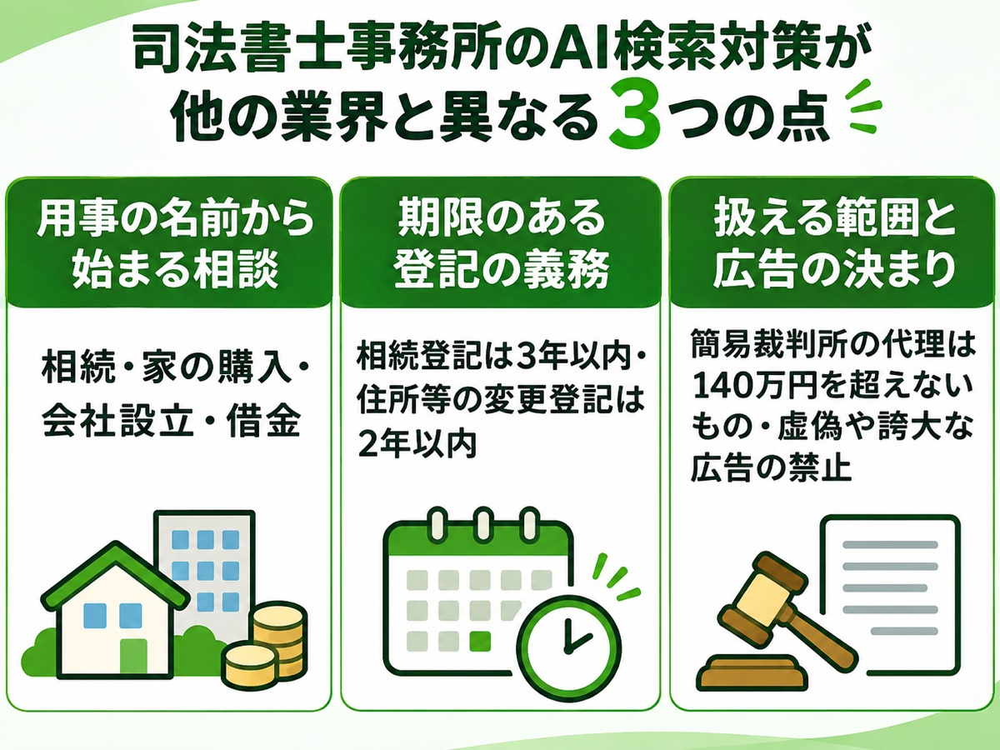
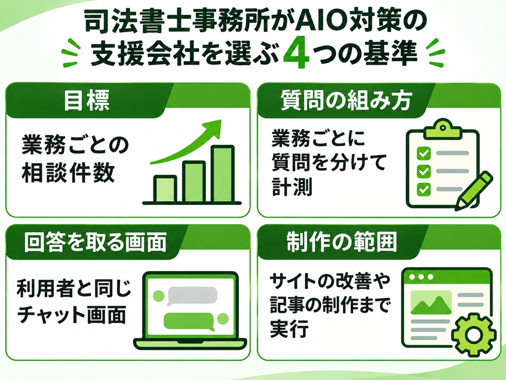

司法書士事務所がAIO対策（AI検索対策）を外部に依頼するなら、**登記や債務整理など業務ごとの相談件数を目標に置き、業務ごとの質問で計測して記事の制作まで実行支援する会社**が向いています。相続・不動産取引・会社の登記のうち、増やしたい依頼がはっきりしている事務所に合う選び方です。

この記事は株式会社nitoが書いているため、自社を1番目に載せました。ほかの6社は各社の公式サイトで読み取れる範囲から、どんな司法書士事務所に合うかで整理しています。

:::takeaways
- 相談する人は**司法書士という資格の名前より先に相続・家の購入・会社設立・借金のような用事の名前から**AIに聞くことがある
- 相続登記は2024年4月、住所等の変更登記は2026年4月から申請が義務になり、**期限や手続きを調べる人の中には自分で申請する方法を探す人もいる**
- 簡易裁判所の代理は認定を受けた司法書士だけが扱え、**対象は140万円を超えないものに限られる**ため、債務整理のページには扱える範囲を書く
- 広告は**所属する司法書士会の会則に従う必要があり、虚偽や誇大な広告は会則で禁じられている**（神奈川県司法書士会会則第92条など）
- 支援会社は**目標・業務ごとの質問・回答を取る画面・制作の範囲**の4つで比べる
:::

## 司法書士事務所のAI検索対策が他の業界と違う点は？

用事の名前から始まる相談・期限のある登記の義務・扱える範囲と広告の決まりの3つで、司法書士事務所は他の業界と異なります。**3つを自分の事務所に当てはめておくことが、支援会社の提案を見る前の準備です。**

<figure class="post-figure post-figure--zu"></figure>

### 用事の名前から始まる相談

司法書士にまだ依頼したことのない人は、事務所を探す前に用事そのものをAIに聞くことがあります。司法書士法第3条が定める業務は、登記や供託の手続きの代理、法務局や裁判所に出す書類の作成、それらの相談などです。日本司法書士会連合会も相談事例を家・土地・借金・相続・会社といった種類に分けて紹介しています。依頼する側から見ると、どれも資格の名前より先に用事の名前で浮かぶ相談です。

| 業務 | 相談のきっかけの例 | AIへの聞き方の例 |
|---|---|---|
| 相続登記 | 親が亡くなり家の名義が親のまま | 親名義の家を相続したら名義変更はいつまでに必要？ |
| 不動産の売買・贈与 | マイホームの購入・配偶者への贈与 | 夫婦間で家を贈与するときの登記の手続きは？ |
| 会社の登記 | 会社の設立・役員の任期の満了 | 株式会社を設立する登記は自分でできる？ |
| 債務整理 | 借金の返済が限度を超えた | 借金の任意整理は司法書士に依頼できる？ |
| 成年後見 | 親の財産の管理が心配 | 認知症の親の預金を管理するにはどうすればいい？ |

成年後見も司法書士が多く担っている業務です。最高裁判所の集計で2025年に後見等の開始と同時に選ばれた成年後見人等（関係別件数）のうち、司法書士（司法書士法人を含む）が11,966件で、弁護士の8,903件や社会福祉士の7,280件を上回りました。**計測する質問も、地域と司法書士の組み合わせだけでなく用事と事情を添えた形を入れておくと、相談する人が実際に見る回答に近い見え方を追えます。**

### 期限のある登記の義務

不動産の登記には期限のある申請の義務が加わりました。法務省によると、相続で不動産を取得した相続人は、取得を知った日から3年以内に相続登記を申請する必要があり、正当な理由なく怠ると10万円以下の過料の対象になります。施行は2024年4月1日で、それより前の相続で登記をしていない不動産も、2027年3月31日まで（相続で取得したことを知ったのが2024年4月以降なら、その日から3年以内）の申請が求められます。

2026年4月1日からは不動産の所有者の住所や氏名の変更登記も義務になりました。変更から2年以内に申請しないと5万円以下の過料の対象になり、施行前の変更も2028年3月31日までの申請が必要です。

期限を調べる人の中には自分で申請する方法を探している人もいます。法務省は相続人申告登記や、申出を1回しておけば法務局が住所の変更を登記するスマート変更登記も案内しています。**自分で申請する方法も書いたうえで、遺産分割がまとまった後の登記は相続人申告登記では義務を果たせないなど、手続きが増える場合を法務省の案内に沿って示しておくと、期限を調べる人が依頼するかどうかを判断できます。**

### 扱える範囲と広告の決まり

司法書士の業務には扱える範囲に線引きがあり、簡易裁判所での訴訟の代理や裁判外の和解の代理は法務大臣の認定を受けた司法書士だけが行える業務です。対象は訴訟や紛争の目的の価額が140万円を超えないものに限られます（司法書士法第3条・裁判所法第33条）。債務整理のページには扱える範囲と、超える場合にどの専門家を案内するかを書いておく必要があります。

広告の決まりを確認する先は所属する司法書士会の会則です。司法書士法第23条は会則を守る義務を定めており、たとえば神奈川県司法書士会の会則は第92条で「虚偽若しくは誇大な広告又は品位を欠く広告」を禁じています。司法書士法施行規則第26条は不当な手段によって依頼を誘致するような行為を禁じており、法務省の懲戒処分の考え方も、会則の不遵守や不当な手段による業務の誘致を処分の対象に挙げています。

報酬については司法書士法施行規則第22条が、依頼を受けようとするときにあらかじめ報酬の基準を示すよう求めています。**広告では「必ず」「地域No.1」のような根拠を示せない言葉を使わず、報酬は登録免許税などの実費と分けて書いておくのがおすすめです。** 支援会社がこの前提を知ったうえで原稿を書けるかは、契約前に聞いておきたい点の1つです。

## 支援会社はどう選べばいい？

司法書士事務所が支援会社を選ぶときは、目標・質問の組み方・回答を取る画面・制作の範囲の4つを最初の打ち合わせで聞くと、各社の違いが見えてきます。

<figure class="post-figure post-figure--zu"></figure>

| 基準 | 確認する質問 | 司法書士事務所で重要な理由 |
|---|---|---|
| 目標 | 何の件数を増やすことを目標にしますか？ | 相続・不動産取引・会社の登記・債務整理では依頼の重みが異なり、分けて数えないと費用に見合うか判断しにくい |
| 質問の組み方 | 業務ごとに質問を分けて計測しますか？ | 業務によって相談する人も添える事情も変わりやすい |
| 回答を取る画面 | 回答は利用者と同じチャット画面から取得していますか？ | プログラム用の窓口（API）の回答とは出典が異なることが多い |
| 制作の範囲 | 分析だけでなくサイトの改善や記事の制作まで実行しますか？ | 期限・報酬・扱える範囲の書き方を誤ると事務所の信用に関わる |

### 業務ごとの相談件数を目標に置くか

言及率は途中の目印として役に立つものの、それだけで依頼は増えません。相続登記の期限を調べる質問で事務所の名前が挙がっても、聞いた人が自分で申請すれば依頼にはならないためです。

**どの業務のどの質問で名前が挙がれば依頼につながるかを先に決め、問い合わせのフォームで業務の種類と何で知ったかまで数える会社**なら、費用に見合うかを依頼の件数で判断できます。

### 業務ごとに質問を組むか

相続登記は家族、会社の登記は経営者、債務整理は借金を抱えた本人というように、業務によって相談する人が変わります。地域名と司法書士の組み合わせに絞った計測では、用事から聞き始める人にどう見えているかが分かりません。業務ごとに家族構成や借入の額などの事情を1つずつ変えた質問を組むと、どの事情で他の事務所に替わるかが見えてきます。

### 利用者と同じ画面で計測するか

回答の集め方にはプログラム用の窓口（API）から取得する方法と、利用者が使うチャット画面に質問して取得する方法があります。2026年9月に公開された論文では、ChatGPTのAPIとチャット画面に同じ質問をしたとき、示された出典の重なりは平均12.0%でした。相続や借金の相談をする人が実際に目にする回答で計測しているかは、レポートの数字を信頼できるかを左右します。

### 分析で終わらず記事の制作まで実行支援するか

AIは事務所のトップページだけでなく、業務ごとのページや報酬・実績などサイトに書かれた情報も読んで、すすめる事務所を選ぶことがあります。そのため事務所が扱う業務と強みの事実を、AIが読み取りやすい形でページに書き起こす必要があります。**分析だけで終わらずサイトの改善や記事の制作まで実行支援する会社**を選ぶのがおすすめです。

司法書士事務所なら、業務ごとの報酬の基準と実費の内訳・相続登記の期限と相続人申告登記の違い・会社の設立から登記の完了までの流れ・債務整理で扱える範囲が、書き起こす内容の候補になります。提案が分析のレポートまでなのか、サイトの改善や記事の制作と公開後の運用まで含むのかは、契約前に確認しておきたい点です。**原稿を事務所の司法書士が公開前に確認する流れまで組めるか**も聞いておくと、公開が止まりにくくなります。

## この記事での選定基準

AI検索対策（AIO・LLMO・GEO）を独立したサービスとして公式サイトに出している会社のうち、AIO対策会社の比較・一覧記事によく挙がる6社を選びました。書き手のnitoは1番目に置いています。

紹介は各社の公式サイトで読み取れる範囲と、どんな司法書士事務所に合うかでまとめています。料金や契約の条件は各社の最新の案内で確認してください。相続の相談に絞った支援会社の選び方は、次の記事で扱っています。

:::linkcard
url: /media/souzoku-aio-companies/
title: 相続の司法書士・行政書士におすすめのAIO対策（AI検索対策）会社7選・選び方
desc: 相続の相談に絞り、面談予約と電話相談を増やす支援会社の選び方を比べています。
:::

## 司法書士事務所におすすめのAIO対策会社7社の比較

強みと、どんな司法書士事務所に向いているかで7社を並べました。

| 会社 | 強み | 向いている司法書士事務所 |
|---|---|---|
| 株式会社nito | 士業の支援実績。計測から記事の制作・公開後の運用まで一気通貫で | 業務ごとの相談件数を増やしたい事務所 |
| ナイル株式会社 | SEOの長い支援実績とLLMOコンサルティング | 相続や登記のコラムが多く、SEOとまとめて依頼したい事務所 |
| 株式会社LANY | SEOとLLMOをまとめたコンサルティングと記事制作 | 法改正や手続きの解説記事を中長期で増やしたい事務所 |
| 株式会社Faber Company | ミエルカGEOなどのツールとGEO/LLMO支援 | 所内の担当者がツールで数字を確認したい事務所 |
| 株式会社ニュートラルワークス | 業界別のサービスとサイト改修までの一括対応 | ホームページの作り直しも検討している事務所 |
| 株式会社PLAN-B | SEOの土台づくり・LLMO/GEOエージェント・AI×業界の調査レポート | 依頼の前に業界の状況を調べたい事務所 |
| 株式会社ジオコード | SEO・Web制作・AI最適化を一社で | 制作とAI検索対策の窓口を1つにしたい事務所 |

料金はnitoを含めどの会社も、対策の範囲や制作の量で変わります。2〜3社から同じ条件で見積もりを取り、4つの基準への答えを並べて比べるのがおすすめです。

業種を問わず依頼先を広く比べたい場合や、費用の相場を知りたい場合は、AIO対策と同じ取り組みを指すLLMO対策の会社20社を比較表で並べた記事が参考になります。

:::linkcard
url: /media/llmo-companies/
title: LLMO対策の会社おすすめ20選・比較表と費用相場・選び方
desc: LLMO対策の会社20社を比較表で並べ、費用相場と選び方を解説しています。
:::

## 1. 株式会社nito

[株式会社nito](/aio/)は、計測から分析、サイトの改善と記事の制作、公開後の運用までを一気通貫で支援するAI検索対策の会社です。何を書き、どこを直すかは、ChatGPTやGeminiなど主要なAIの実際の回答を毎晩読み、他社が選ばれている理由から決めます。士業の支援実績もあり、**追いかける数字はAIでの言及率ではなく、登記や債務整理などの相談の件数です。**

相続登記や会社の設立の登記は、依頼する人にとって何度もある手続きではありません。そのため名前が挙がる質問をむやみに増やすより、用事と事情を添えて聞いた人に理由つきで挙がる状態をつくることを優先します。

### 司法書士事務所に合う理由

- **業務ごとに質問を組む。** 相続登記・不動産の売買や贈与・会社の登記・債務整理・成年後見に分け、家族構成や借入の額などの事情を添えた質問を設計する
- **実際のチャット画面で計測する。** 相談する人が見る回答のまま、回答本文と引用元を毎晩記録する。これまでに記録した回答は3万件を超える（2026年11月時点）
- **他の事務所が挙がる理由を回答本文から抜き出す。** AIが他の事務所を勧めるときに添えた理由のうち、自分の事務所にも当てはまるのにページに書いていないものを、新しく書く内容の候補にする
- **業務ごとの記事を作り、公開後も運用する。** 自分で申請する場合との違いを書いた相続登記の記事や、報酬の基準と実費を分けた料金のページを作る。公開の判断は事務所の司法書士に委ね、公開後は回答の変化を見て書き方を修正する
- **問い合わせまで数える。** フォームに業務の種類・何で知ったか・AIに何を聞いたかの項目を入れ、AIで知った人からの依頼の件数まで追う

お客様にお願いするのはヒアリング・公開前の確認・実装の3点だけです。

### これまでの成果

| 支援先 | 成果 |
|---|---|
| SaaS企業 | 取り組み3ヶ月で、AIでの言及率が10%から45%に。AI経由のコンバージョンは5ヶ月で約6.7倍 |
| 士業 | AIでの言及率が0%から20%に。新しいページは公開3日でAIの回答の引用元に |

成果の出方は事業・体制・地域しだいです。どの質問でどこまで狙えるかは、無料の現状分析のあとにお伝えしています。

### こんな事務所に向いている

- 相続・不動産取引・会社の登記・債務整理のうち、増やしたい依頼がはっきりしている司法書士事務所
- 所内に記事を書く人がおらず、計測から原稿の作成まで窓口を1つにしたい事務所
- 言及率のレポートより、依頼の件数で効果を確認したい事務所

:::point
nitoでは相談する人が聞きそうな質問をChatGPTやGeminiなど主要なAIに実際に入力し、事務所の名前が挙がるか、どう紹介されるか、代わりにどの事務所が挙がるかをまとめた[現状分析レポート](/aio/)を無料でお出ししています。
:::

## 2. ナイル株式会社

ナイル株式会社はSEOコンサルティングを長く手がけてきたマーケティング支援会社です。LLMO（AI検索対策）コンサルティングをSEOのサービスと並べて提供しており、検索とAIの両方の対策を1つの窓口で相談できます。

**相続や登記のコラムをすでに多く公開していて、SEOで積み上げた記事をAI検索にも生かしたい司法書士事務所**に向いています。

## 3. 株式会社LANY

株式会社LANYはSEOを軸にしたデジタルマーケティングの支援会社です。LLMOコンサルティングに加えて、SEO/LLMO向けの記事制作やLP制作も扱っています。

**法改正や手続きの解説記事を中長期で増やし、記事の本数もまとめて任せたい事務所**に合います。

## 4. 株式会社Faber Company

株式会社Faber CompanyはSEOツール「ミエルカSEO」の提供元です。AI検索での見え方を確認するツール「ミエルカGEO」と、GEO/LLMO支援のコンサルティングを用意しています。2026年11月にはミエルカGEOの累計契約社数が2026年9月末時点で100社を超えたと発表しました。

**所内にWebの担当者がいて、ツールで事務所の数字を見ながら改善を進めたい事務所**に向いています。

## 5. 株式会社ニュートラルワークス

株式会社ニュートラルワークスはWeb制作と集客支援を行う会社です。LLMO対策（AI検索最適化対策）を扱い、建設・不動産・クリニックなど業界別のAI検索最適化のサービスも出しています。Web制作の会社のため、サイトの改修まで同じ窓口で依頼できます。

**ホームページが古く、AI検索対策とあわせて作り直しも検討している事務所**に合います。

## 6. 株式会社PLAN-B

株式会社PLAN-BはSEOコンサルティングを長年手がけてきた会社です。2026年10月にはSEO実行支援ツール「SEARCH WRITE」を更新し、AI検索上の自社ブランドの可視化・分析から改善提案までを支援する「LLMO/GEOエージェント」の提供を始めました。生成AIが業界ごとにどの会社を勧めるかを調べた「AI×業界調査レポート」も出しており、SEOの土台づくりとあわせてAI検索の状況を調べられます。

**運用を任せる前に、自社の業界でAIがどの会社を勧めているかを把握しておきたい事務所**に向いています。

## 7. 株式会社ジオコード

株式会社ジオコードはSEO・コンテンツ・Web制作に加え、AIO・LLMOなどのAI最適化も支援する会社です。Webマーケティングを一社で完結させる体制が特徴です。

**ホームページの制作とSEOとAI検索対策を、窓口を分けずに依頼したい司法書士事務所**に合います。

## 依頼する前に事務所で整備しておくこと

どの会社に依頼する場合も、次の5つを事前に整理しておくのが、最初の提案を事務所の業務に合わせる近道です。

1. **ウェブ経由の問い合わせの月の件数と、業務ごとの内訳。** 相続・不動産取引・会社の登記・債務整理・成年後見に分けておくと、増えたかどうかを比べる起点になります
2. **業務ごとの1件の価値。** 報酬の目安と、問い合わせの何件に1件が依頼に進むかを出しておくと、支援にかけてよい費用の上限が見えます
3. **報酬の基準と実費の内訳。** 登記の種類ごとに、報酬と登録免許税などの実費を分けて書ける形にしておきます
4. **受ける業務と受けない業務。** 認定司法書士として扱う範囲・対応できる地域・弁護士や税理士などほかの専門家に任せる範囲を先に決めておきます
5. **ページを更新できる人と、公開前に確認する司法書士。** 法改正の施行に合わせて期限や手続きの記載を見直す時期を決めておくと、古い情報が残りにくくなります

[blogparts:llmo-cta]

## まとめ

- 増やしたい業務がはっきりしているなら、業務ごとの相談件数を目標に置き、計測から記事の制作まで実行支援する会社が向いている
- 相続や登記のコラムが多くSEOとまとめて依頼したいなら、SEOの支援を長く手がける会社が候補
- 所内で数字を見ながら改善したいなら、計測のツールを持つ会社を選ぶと進めやすい
- ホームページの作り直しも検討しているなら、Web制作まで扱う会社がおすすめ
- どの会社に依頼しても、報酬・期限・扱える範囲の書き方は公開前に事務所の司法書士が確認する

## よくある質問

### 司法書士事務所にAIO対策は必要ですか？

相続登記の期限や会社の設立の手順を、事務所に電話する前にAIで調べる人もいます。その流れで依頼先を聞いたときに名前が挙がれば、比べる候補に入りやすくなります。紹介で依頼を受けている事務所でも、紹介された人が事務所名をAIや検索で確認することがあります。

### AIO対策とLLMO対策は違いますか？

どちらもAIの回答の中で事務所の名前が挙がるようにする取り組みで、進め方に大きな差はありません。GoogleのAIによる概要やAIモードを中心にするときはAIO、ChatGPTやGeminiなどの対話型AIまで含めるときはLLMOと呼ぶことが多くなっています。AIO対策の呼び方で依頼先を比べた記事は「[AIO対策会社おすすめ20選](/media/aio-taisaku-companies/)」です。

### 相続登記を自分で申請する方法を書くと依頼が減りませんか？

自分で申請する方法を調べる人は、事務所のページが無くても公的な案内などで手順を知ることができます。そのうえで手順と手間を書き、遺産分割がまとまった後は相続人申告登記だけでは義務を果たせないなど、手続きが増える場合を法務省の案内に沿って示しておくと、迷っている人が依頼するかどうかを判断できます。

### 債務整理のページで気をつけることは何ですか？

扱える範囲を正確に書くことです。司法書士が簡易裁判所の代理や裁判外の和解の代理を行えるのは法務大臣の認定を受けた場合に限られ、対象は140万円を超えないものです。範囲を超える場合にどうするかも書いておくと、相談する人が迷わずに済みます。

### 報酬をホームページに載せても問題ありませんか？

事実に沿った書き方なら、載せること自体に問題はありません。司法書士法施行規則第22条は、依頼を受けようとするときにあらかじめ報酬の基準を示すよう求めています。神奈川県司法書士会の会則も、報酬の金額または算定方法を事務所の見やすい場所に掲示するなどして明らかにするよう定めています。報酬と登録免許税などの実費を分け、金額が変わる条件を添えて書くのがおすすめです。

### 依頼者の事例はページに書けますか？

個人や会社が特定されない形にすれば、事例として書く事務所もあります。氏名や地域は伏せ、相続人の数や不動産の数などの条件と手続きの流れを中心にまとめます。司法書士には司法書士法第24条で秘密を守る義務があるため、公開の範囲は依頼者の了承をとったうえで判断してください。

### 言及率が上がれば依頼も増えますか？

必ずしも増えません。名前が挙がる質問が制度を調べるものばかりなら、聞いた人が自分で申請して終わることもあるためです。どの業務のどの質問で挙がったかと、問い合わせのフォームでAIで知ったと答えた人の数を合わせて見る必要があります。

### AIO対策の効果が出るまでどのくらいかかりますか？

地域や業務ごとの競合の多さと、事務所のページにある情報の量で変わります。nitoでは現状を計測したうえで、どの質問でいつごろまでに何を目指すかをお伝えしています。

## 出典

- e-Gov法令検索「[司法書士法](https://laws.e-gov.go.jp/law/325AC1000000197)」（第3条・第23条・第24条）「[司法書士法施行規則](https://laws.e-gov.go.jp/law/353M50000010055)」（第22条・第26条）「[裁判所法](https://laws.e-gov.go.jp/law/322AC0000000059)」（第33条）
- 神奈川県司法書士会「[神奈川県司法書士会会則](https://www.shiho.or.jp/wp-content/uploads/2023/06/9636f9a5dcb9df86ac800f06572f11f2.pdf)」（第92条・第95条）
- 法務省民事局「[司法書士及び司法書士法人に対する懲戒処分の考え方（処分基準等）](https://www.moj.go.jp/content/001325581.pdf)」
- 法務省「[相続登記の申請義務化について](https://www.moj.go.jp/MINJI/minji05_00599.html)」「[住所等変更登記の義務化について](https://www.moj.go.jp/MINJI/minji05_00693.html)」
- 日本司法書士会連合会「[こんなときは司法書士](https://www.shiho-shoshi.or.jp/consulting/)」
- 最高裁判所事務総局家庭局「[成年後見関係事件の概況（令和7年1月〜12月）](https://www.courts.go.jp/assets/20260316koukengaikyou-r7.pdf)」
- Faber Company「[ミエルカGEO、累計契約社数100社を突破](https://www.fabercompany.co.jp/news/mierucageo-100/)」（2026年11月5日）
- PLAN-B「[SEARCH WRITEのアップデート（LLMO/GEOエージェント）](https://www.plan-b.co.jp/news/search-write_update_202610/)」（2026年10月19日）
- 各社の公式サイト（2026年11月17日確認）: [ナイル株式会社](https://nyle.co.jp/)・[株式会社LANY](https://www.lany.co.jp/)・[株式会社Faber Company](https://www.fabercompany.co.jp/)・[株式会社ニュートラルワークス](https://n-works.link/)・[株式会社PLAN-B](https://www.plan-b.co.jp/)・[株式会社ジオコード](https://www.geo-code.co.jp/)
- APIとチャット画面の出典の重なり: Uberti-Bona Marin ほか「[Auditing AI-Generated Product Recommendations](https://arxiv.org/abs/2609.18729)」（arXiv、2026年9月）
