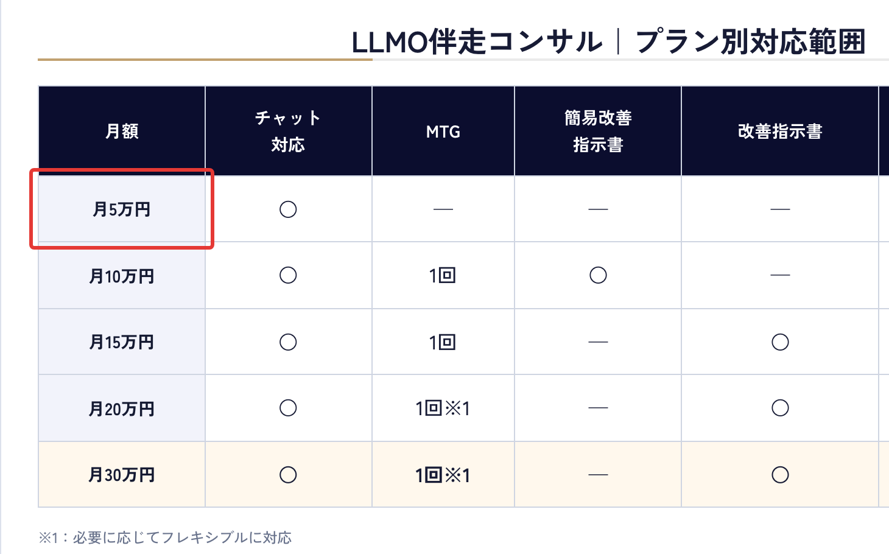
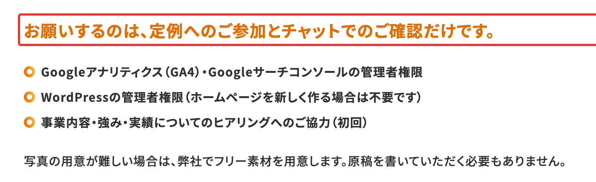

中小企業のAIO対策は、強み・事例・よく聞かれる質問のような社内にしか無い情報を自社で整え、記事の制作やサイトの修正を社内で回せない分だけ会社に頼むと、少ない予算でも始められます。依頼先は月額の安さより、最低契約期間と社内に残る作業で選ぶのがおすすめです。

この記事は株式会社nitoが書いていて、自社を1番目に載せました。中小企業向けのプランか少額の窓口を公式に載せる9社を、最低の月額・最低契約期間・社内に残る作業の3点で比べています。

:::takeaways
- 社内にしか無い情報は外に頼んでも聞き取りから始まるため、先に自社で整えておくと費用を抑えられる
- 公式の最低の月額は計測ツールの月3万円から。記事やサイトの修正まで任せられるのは月15万〜22万円のプランから
- 同じ月額でも、最低契約期間（なし・3か月・6か月）と社内に残る作業で総額と手間が変わる
:::

## 中小企業のAIO対策はどう進める？

**社内に記事を書く人とサイトを修正する人がいるかどうかで、自社でやる範囲と会社に頼む範囲が決まります。** AIO対策はChatGPTやGemini、GoogleのAIによる概要などの回答で自社の名前が挙がり、自社のページが引用されるようにする取り組みです。LLMO対策やGEO対策と呼ぶ会社もありますが、依頼できる中身はほぼ同じです。

Googleは公式ガイドで、生成AI検索でも「SEO のベスト プラクティス は引き続き有効です」と書いています。AIO対策は新しいサイトを用意する話ではなく、今のサイトを土台に、AIが答えの材料に使える情報を増やしていく作業です。

| 社内の状況 | 自社でやること | 会社に頼むこと |
|---|---|---|
| 書く人も修正する人もいる | 情報の整理・記事・サイトの修正 | 計測と方針の助言 |
| 修正する人はいるが書く人がいない | 情報の整理・サイトの修正 | 記事の制作と計測 |
| どちらもいない | 情報の提供と公開前の確認 | 計測から記事の制作・サイトの改善まで |

どの状況でも、次の節の作業を先に済ませると頼む範囲が小さくなり、見積もりも比べやすくなります。中小企業がAIの回答で選ばれやすい理由は[中小企業がAI検索で大手に勝てる理由](/media/smb-beats-big-ai-search/)にまとめました。

:::linkcard
url: /media/llmo-inhouse-vs-outsource/
title: AI検索対策は内製と外注どちらがいい？自社でできる範囲と頼るべき範囲
desc: 作業を工程に分けて、内製で進める部分と外部に任せる部分の分け方を解説しています。
:::

## 自社でできるAIO対策は？

**会社に頼んでも社内への聞き取りから始まる作業は、先に自社で済ませておくと月額を抑えられます。** 費用はかからず、多くは数時間で着手できる作業です。

### 自社と競合の見え方の確認

ChatGPTやGemini、Googleの検索で、3種類の質問を自社の業種と地域に置き換えて聞きます。1つ目は社名を入れた質問で、見るのは説明が正しいかどうかです。2つ目は「〇〇市で△△を頼める会社は？」のような地域と業種の質問で、**見込み客は社名を知らない段階でこの形で聞くため、ここで自社が挙がるか、代わりにどの会社が挙がるかが一番の手がかりになります。** 3つ目は「△△の費用はいくら？」のような悩みの質問で、自社のページが出典に使われるかを見ます。

AIの回答は聞くたびに同じとは限りません。質問を固定して月に1回、新しいチャットで同じ条件で記録すれば、施策の前後を比べられます。

### 会社とサービスの情報を文で書く

対応エリアは市区町村名で、対象の顧客は業種や規模で、料金は目安か決まり方で、サイトに文として書きます。**対応しないことも書いておくと、条件で探す見込み客と照らし合わせやすくなります。** 料金表を画像だけで載せている場合は、同じ内容をテキストでも載せるのが安全です。

古い料金や退職した担当者の紹介が残っていれば、ここで修正します。Googleは公式ガイドで、Googleビジネスプロフィールなどのサービスを使うと、AIの回答とGoogle検索の両方でローカルビジネスの情報を表示できる場合があるとしています。社名・住所・電話番号の表記は、サイトとビジネスプロフィールで統一しておくと確実です。

### よく聞かれる質問と事例の追加

営業の場や問い合わせのメールで実際に聞かれる質問を10個ほど集め、回答の1文目で結論を書いたFAQにします。社内にしか無い質問なので、ほかの会社が同じものを用意できません。

事例は「A社様」で終えず、業種・規模・課題・結果・期間まで書くのがおすすめです。社名を出せない場合も、業種と規模があれば、AIが「うちと似た会社の事例はあるか」という質問に使える材料になります。

### AIで知った問い合わせを数える

AIの回答から来た人はアクセス解析で参照元が分からない形で入ることがあります。**問い合わせフォームの「何で知りましたか」に、ChatGPTやGeminiなどのAIという選択肢を追加しておくと、AI経由の問い合わせを数えられます。** Googleの生成AI機能での表示は、Search Consoleの生成AIパフォーマンスレポートで確認が可能です。

### 予算をかけなくてよい作業

Googleは同じガイドで、Google検索ではコンテンツのチャンク化やllms.txtの作成、不自然な言及の追求は「無視できます」とし、「生成 AI 検索に構造化データは必要ありません」とも書いています。構造化データはリッチリザルトのためにSEOの一部として使うのは推奨されているので、見積もりの中心がこうした作業なら、何のための作業かを確認してください。

ここまでの作業のうち、続けられずに止まりそうな所が、会社に頼む範囲です。

## 中小企業のAIO対策会社9選の比較表

### この記事の選定基準

載せたのは**中小企業向けのプランか月10万円前後までの窓口を公式サイトに載せ、2026年11月23日時点で提供していて、料金か支援範囲が公式の記載から読める**8社と、書き手のnitoです。nitoを1番目に置き、ほかは最低の月額が低い順、見積もりだけの会社を最後に並べました。公式に記載が無い項目は「記載なし」と書いています。

### 9社の比較表

| 会社 | 最低の月額（公式） | 最低契約期間 | 社内に残る作業 |
|---|---|---|---|
| 株式会社nito | 無料の現状分析のあと見積もり | 見積もり時に案内 | ヒアリング・公開前の確認・サイトへの反映 |
| DolphinX AIO（メディアリーチ） | 月3万円（税別・計測ツール） | 6か月 | 分析と改善のすべて |
| 株式会社Mesut | 月5万円（税別・チャット相談） | 記載なし | 一次情報の提供・公開前の確認・情報の更新 |
| AtoZ Design | 月5.5万円（税込・内製化支援）、初期11万円 | 6か月 | 記事の制作（書き方の指導つき） |
| エイチリンク株式会社 | 月7万円（税別・助言のみ） | なし | 月7万円は実行のすべて、月22万円は権限の付与と確認 |
| アムール株式会社 | 月10万円（税抜・助言） | 6か月 | 施策の実行（実行支援は月30万円から） |
| ウェブココル株式会社 | 月10万円〜（対策するAIを1つに絞る） | 記載なし（全AI対応は6か月〜） | 記載なし |
| フォワードX株式会社 | 月15万円（税抜・記事月3本まで） | 3か月 | 記載なし（必要な対応は案内を受ける） |
| 株式会社NEXER Group | 個別見積もり（同社の解説記事では月20万円〜） | 記載なし | 記載なし |

**表の金額は各社が公式に出している最小の構成で、含まれる作業は会社ごとに大きく違います。** この9社では月10万円以下のプランは計測か助言が中心で、実行は社内に残る形がほとんどです。税込と税別の表記も会社ごとに異なるので、見積もりでは同じ条件にして比べてください。

## 9社の特徴

### 1. 株式会社nito

**[株式会社nito](/llmo/)**: AI検索対策を、問い合わせや購入が増えるところまで受け持つ会社です。見込み客がChatGPTやGeminiなど主要なAIに質問したときの回答を実際のチャット画面で毎日記録し、他社が推される理由を回答の本文から読み取ったうえで、サイトの改善と記事の制作、公開後の運用までを一気通貫で支援します。

- **社内に書く人がいなくても進められる。** 依頼側にお願いするのは、強みを聞き取るヒアリング・公開前の確認・サイトへの反映の3つです
- **計測の結果を一緒に見られる。** 記録した回答は3万件を超え（2026年11月時点）、推移は専用のダッシュボードで確認できます
- **効果は問い合わせの数で判断する。** AIでの露出の割合だけでなく、AIで知って問い合わせた人の数まで追います

| 支援先 | これまでの成果 |
|---|---|
| SaaS企業 | AIでの言及率が3ヶ月で10%から45%に。5ヶ月でAI経由のコンバージョンが約6.7倍に |
| 士業 | AIでの言及率が0%から20%に。新しいページは公開3日でAIの回答の引用元に |

2026年11月からは注文住宅の会社のAI検索対策も支援しています。料金は狙う質問の数と記事の本数で決める月額制で、狙いたい質問をAIに聞いた結果をまとめた[無料の現状分析レポート](/llmo/)のあとに見積もりをお出しします。

- 社内に記事を書く人がおらず、記事の制作と公開後の運用まで任せたい会社
- AIでの露出の数字より、問い合わせの数で費用に見合うかを判断したい会社

### 2. DolphinX AIO（株式会社メディアリーチ）

**DolphinX AIO**: 自社で運用するAIO対策の計測ツールです。ライトプランは月3万円（税別、6か月契約、初期費用0円）で、登録した最大20個の質問をChatGPTやGeminiなどに毎日投げ、自社の言及と引用を記録します。12か月契約なら月2.7万円になり、無料試用は14日間です。個社ごとの分析や戦略、レポートの作成は無償サポートの対象外なので、**数字を見てページを修正する人が社内にいる会社**に向いています。

### 3. 株式会社Mesut

**株式会社Mesut**: 「中小企業向けLLMO対策」のページを持つ会社で、無料診断（毎月5社限定）のあと、スポット改善10万円からか、伴走の月5万円から（いずれも税別）を選べます。月5万円はチャット相談だけで、打ち合わせと簡易の改善指示書が付くのは月10万円、改善指示書は月15万円、KPIの管理は月20万円からです。依頼側の担当を対象顧客や料金などの一次情報の提供・公開前の確認・情報の更新と公式に書き分けていて、**社内に何が残るかを契約前に読み取りやすい会社**です。代表が全案件に直接対応するとしています。

<figure class="post-figure"><figcaption>Mesutの伴走コンサルのプラン別対応範囲（一部、2026年11月23日）</figcaption></figure>

### 4. AtoZ Design

**AtoZ Design**: 岡山のホームページ制作会社で、LLMO・AIO対策のコンサルティングも受けます。初回に初期分析・設計11万円がかかり、その後は内製化サポート月5.5万円か、フルコンサルティング月11万円（どちらも税込、6か月から）です。内製化サポートは月1回の打ち合わせで記事の企画や構成、書き方の指導を受ける形なので、**記事を自社で書く人がいる会社**に合います。記事の制作は1本3.3万円（6か月から、毎月2本から）で別に依頼でき、相談は全国からオンラインで受けています。

### 5. エイチリンク株式会社

**エイチリンク株式会社**: サービス名に「中小企業向け」と入れ、初期費用0円・最低契約期間なしで始められる会社です。月7万円（税別）は月1回の定例と改善箇所の指摘、推薦率と引用数のレポートまでで、実行は社内に残ります。**月22万円（税別）になると、構造化データの実装やサービスページとFAQの書き直し、比較メディアへの掲載交渉まで代行します。** そのとき依頼側が用意するのは、GA4・Search Console・WordPressの管理者権限と、初回のヒアリング、定例とチャットでの確認で、原稿の執筆は依頼側の作業に含まれていません。

<figure class="post-figure"><figcaption>エイチリンクの契約で依頼側が用意するもの（2026年11月23日）</figcaption></figure>

### 6. アムール株式会社

**アムール株式会社**: AIOアドバイザリーが月10万円（税抜、稼働の目安は月5〜10時間）で、チャットでの質問は無制限、月1回の打ち合わせと競合5アカウントのベンチマークが付きます。施策の実行支援と月次のLLMOレポートは月30万円のAIO伴走支援からで、初期費用は無料、最低契約期間は6か月です。**まず方針と優先順位を固めたい会社**に向いています。

### 7. ウェブココル株式会社

**ウェブココル株式会社**: 「地域を制するAI検索対策」を掲げる会社で、東証グロース上場のデジタリフトのグループです。ChatGPT、Gemini・Googleマップ、AI Overviews・AIモードのうち対策するAIを1つ選ぶプランが月10万円から、全AI対応が月15万円から（6か月から）です。最初に見込み客が使う質問を100問設計して回答を計測し、再測定と改善提案は四半期に1回です。料金は契約期間とサイトの規模で変わるとしていて、**地図や地域名の質問から来る客が多い店舗・地域の会社**に合います。

### 8. フォワードX株式会社

**フォワードX株式会社**: AIO支援のベーシックが月15万円（税抜、初期費用なし、最低3か月）で、新規コンテンツの作成が月3記事まで、FAQや構造化データの提案、競合3社までの分析、月次の定例とレポートが入ります。月30万円のプロフェッショナルでは記事が月10本までになり、WordPressの簡易修正やAI経由の流入分析が加わります。社内に専門の担当者がいなくても進められるとしていて、**記事の制作を月額に含めて頼みたい会社**の候補です。

### 9. 株式会社NEXER Group

**株式会社NEXER Group**: 2005年の創業から5,000社以上のWeb集客を支援してきた会社で、AIOコンサルティングは無料の診断で足りない施策を特定してから見積もる形です。同社の解説記事では月20万円からとしています。施策は一式でなく不足分から段階的に始められ、ほかの会社にSEOを頼んでいてもAIO対策だけを任せられます。中心の顧客は中小企業で、専任の担当者がいなくても戦略設計から実行まで代行するとしています。

## 月の予算別にどこまで頼める？

**月10万円以下のプランは計測か助言が中心で、記事やサイトの修正まで任せられるのは月15万〜22万円のプランからです。** 帯ごとに社内に残る作業が変わります。

### 月5万円前後まで

DolphinX AIOの月3万円は計測ツール、Mesutの月5万円はチャット相談、AtoZ Designの月5.5万円は書き方の指導です。**どれも記事を書く作業とページを修正する作業は社内に残ります。** たとえばAtoZ Designの内製化サポートなら、初期11万円に月5.5万円×6か月を足して、最初の契約で44万円（税込）です。社内に書く人がいて、方向だけ借りたい会社の帯です。

### 月10万〜15万円

アムールの月10万円とエイチリンクの月7万円は助言と改善箇所の指摘、Mesutの月15万円は改善指示書までで、修正は社内か制作会社が行います。ウェブココルの月10万円は対策するAIを1つに絞る形です。**この帯で記事の制作まで月額に入るのは、フォワードXの月15万円（月3記事まで）です。** 指摘を受けたあとに誰がサイトを修正するかを決めてから選ぶと、手が止まりにくくなります。

### 月20万円以上

エイチリンクの月22万円はサイトの改善や掲載交渉の代行まで、アムールの月30万円は施策の実行支援まで、フォワードXの月30万円は記事が月10本までです。NEXER Groupの解説記事も月20万円からという記載です。社内に書く人も修正する人もいない会社は、この帯から探すと、ヒアリングと確認だけで回る形を組みやすくなります。

帯を決めたら2〜3社に同じ質問の数と記事の本数で見積もりを依頼すると、差を並べて見られます。

:::linkcard
url: /media/llmo-cost/
title: LLMO・AIO対策の費用相場はいくら？月額の目安と失敗しない依頼先の選び方
desc: 費用の内訳と、見積もりで範囲を見誤らないための見方を解説しています。
:::

## 契約の前に確認すること

**見積もりの行ごとに「誰が作業するか」を書いてもらうと、月額の違う会社どうしでも比べられます。** 中小企業では社内の誰かが兼任で窓口を受け持つことが多いため、ここが合わないと契約後に進みません。

### 社内に残る作業

記事は月に何本で、誰が書くのか。サイトの修正は誰が行い、そのために管理者権限を渡すのか、今の制作会社に頼むのか。**今の制作会社に修正を頼む場合は、その費用が見積もりとは別にかかります。** 依頼側が出す一次情報（強み・事例・料金の条件）と、確認にかかる時間の目安も聞いておくと安心です。

### 契約期間と解約の条件

最低契約期間はエイチリンクのようにないもの、フォワードXの3か月、アムールやAtoZ Design・DolphinX AIOの6か月と分かれます。月額に期間を掛けた総額と自動更新の有無、解約の連絡の期限も、見積もりの段階で確認が必要です。

### 成果の数え方と保証

計測に使う質問・AIの種類・頻度が見積もりに書かれているかが、1つ目の確認点です。言及や引用の割合だけでなく、AIで知った問い合わせまで数えるかも聞いておくと、続けるかどうかを社内で判断しやすくなります。Googleは「インデックス登録と配信は保証されているものではありません」とし、Googleの内部の指標を使っているとうたうツールにも注意を促しています。**表示を約束する提案を受けたら、根拠を確認してから判断するのが安全です。**

## まとめ

- 書く人も修正する人も社内にいるなら、計測ツールか助言のプラン（月3万〜10万円）で方向だけ借りる
- 修正する人はいて書く人がいないなら、記事の制作が月額に入るプランを選ぶ
- どちらもいないなら、実行まで代行する会社に頼み、社内はヒアリングと確認に絞る
- どの帯でも、最低契約期間を掛けた総額と、社内に残る作業を見積もりの行で比べる

## よくある質問

### 中小企業でもAIO対策の会社に頼めますか？

頼めます。エイチリンクとMesutは中小企業向けのページを持ち、NEXER Groupも中心の顧客は中小企業としています。nito・Mesut・フォワードX・NEXER Group・AtoZ Designは無料の診断や分析を用意しているので、今の見え方を知ってから頼む範囲を決められます。

### AIO対策は月10万円以下でも頼めますか？

頼めますが、計測か助言が中心です。DolphinX AIOは月3万円、Mesutは月5万円、AtoZ Designは月5.5万円、エイチリンクは月7万円からで、記事の制作やサイトの修正は社内に残ります。NEXER Groupが2026年9月に51社の公開料金を集めた記事では、月額は5万〜70万円で、中央値は30万円でした。

### AIO対策は自社だけでできますか？

自社と競合の見え方の確認、会社とサービスの情報の整理、FAQと事例の追加は自社でできます。毎月の計測や記事の制作を続ける人手が無い場合に、その部分を会社に頼むと進めやすくなります。

### 最低契約期間なしで頼めるAIO対策会社はありますか？

エイチリンクは最低契約期間を設けておらず、前月末までの連絡で解約できます。ただし同社も、効果を見るには半年以上の継続が望ましいという立場です。フォワードXは3か月、アムール・AtoZ Design・DolphinX AIOは6か月からです。

### AIO対策の効果はどれくらいで出ますか？

NEXER Groupとウェブココルは、変化が見え始めるまで3〜6か月を目安にしています。エイチリンクの案内でも目に見えた成果は半年後以降のケースがほとんどです。nitoの支援先では新しいページが公開3日でAIの回答の引用元に入った例もあり、競合の多さとページの中身で差が出ます。

### SEOを別の会社に頼んでいてもAIO対策だけ頼めますか？

頼めます。NEXER GroupはAIO対策だけのスポット支援に対応するとしています。どちらが構造化データやページの修正を受け持つかを、契約の前に決めておくと作業が重なりません。

### llms.txtや構造化データは中小企業にも必要ですか？

Google検索に向けては必要ありません。Googleは公式ガイドで、Google検索はllms.txtを使わず、生成AI検索に構造化データは必要ないとしています。リッチリザルトのための構造化データはSEOとして使い続けてよいので、見積もりに入っていれば目的を確認してください。

### 地方の中小企業でもAIO対策を依頼できますか？

依頼できます。エイチリンクはオンラインの打ち合わせで全国に対応し、AtoZ DesignもGoogle Meetで全国から相談を受けています。打ち合わせの形と頻度も、見積もりの段階で確認しておくと安心です。

## 出典

- 各社の公式サイト（2026年11月23日確認）: [nito AI検索対策](/llmo/)・[DolphinX AIO 料金プラン](https://dolphinx.jp/aio/pricing)・[Mesut 中小企業のLLMO対策](https://mesut.co.jp/service/llmo/small-business/)・[AtoZ Design LLMO・AIO対策コンサルティング](https://atoz-design.jp/service/llmo/)・[エイチリンク 中小企業向け AIOコンサルティング・AIO対策代行](https://h-link-marketing.co.jp/service/llmo-consulting/)・[アムール AIOコンサルティング](https://amour-inc.jp/service/aio-consulting/)・[ウェブココル LLMO月額コンサルティング](https://challenge-seo.jp/local-llmo/)・[フォワードX AIO支援サービス](https://forwardx.net/aio/)・[NEXER Group AIOコンサルティング](https://nexer.co.jp/marketing/aio)
- NEXER Group「[中小企業のAIO対策｜何から始めるか・自社でできる範囲・外注の判断基準](https://nexer.co.jp/blog/small-business-aio)」（月額20万円〜の記載、51社の公開料金の集計）
- Google 検索セントラル「[Google 検索の生成 AI 機能向けにウェブサイトを最適化する](https://developers.google.com/search/docs/fundamentals/ai-optimization-guide?hl=ja)」（2026年11月23日確認）
- nitoの支援先の数字: 言及率は質問単位の実測、AI経由のコンバージョンは会員登録時のアンケート
