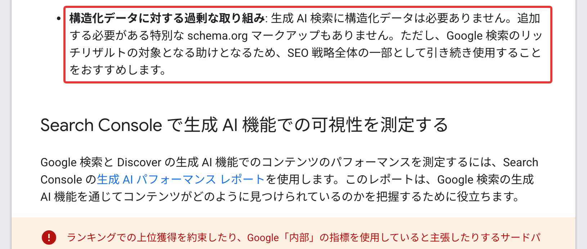
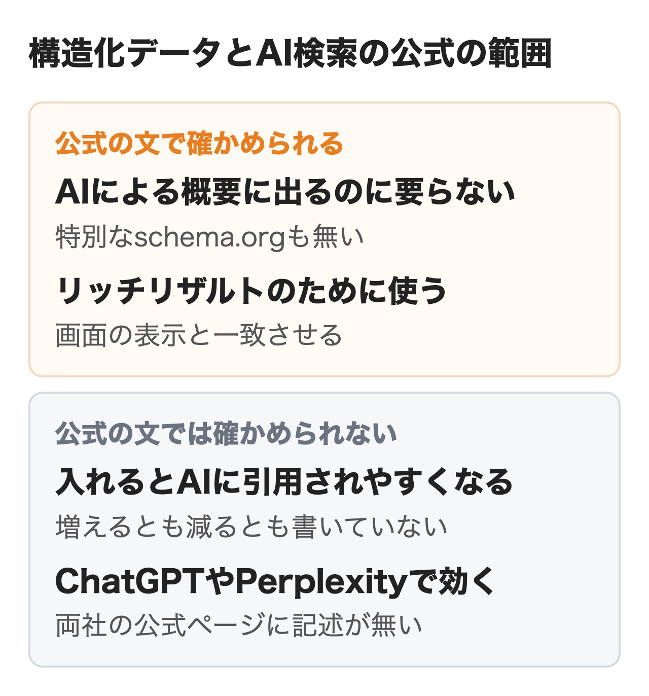
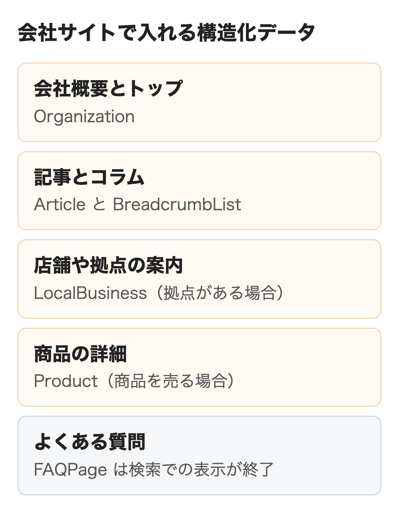
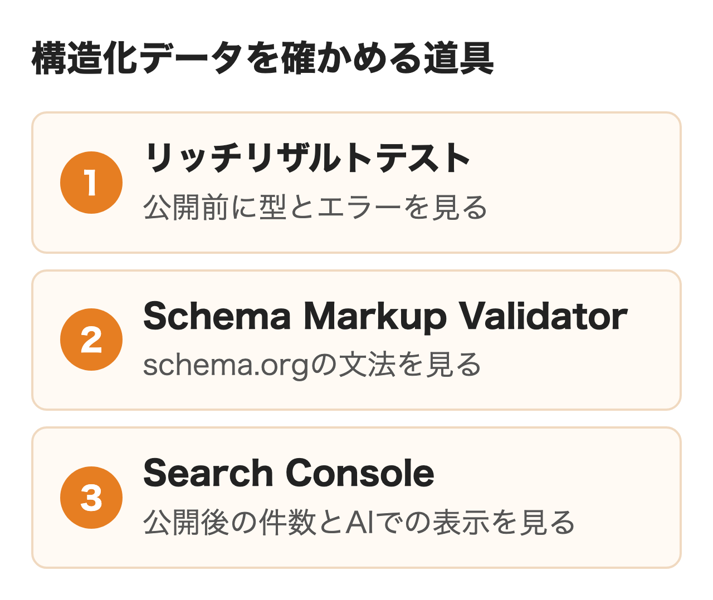

Googleは2026年5月に公開した生成AI機能向けの最適化ガイドに、「生成 AI 検索に構造化データは必要ありません」と書きました。同じ月の7日からはFAQのリッチリザルトも検索結果に出なくなっています。

それでも、構造化データを入れればAIに引用されやすくなるという説明はよく見かけます。この記事ではGoogleなど各社の公式の文で確かめられる範囲と確かめられない範囲を分けたうえで、会社のサイトで入れる種類、JSON-LDの入れ方、入れたあとの確かめ方までを書きます。

:::takeaways
- Googleは**生成AI検索に構造化データは要らず、特別なschema.orgのマークアップも無い**と明記している。リッチリザルトのためには使い続けるよう勧めている
- 入れるとAIに引用されやすくなる、という文は**Google・OpenAI・Perplexityの公式ページに見当たらない**。増えるとも減るとも書かれていない
- 会社サイトで先に入れるのは**Organization・Article・BreadcrumbList**。FAQPageとHowToはGoogle検索での表示が終わっていて、手書きの分は見直しの対象になる
:::

## 構造化データとは

構造化データはページに書いてある会社名・記事の公開日・価格などに、何の情報かという項目名を付けて検索エンジンに渡す仕組みです。人が読む本文とは別に、機械が読む形で同じ事実を添えます。

項目名の辞書にあたるのがschema.orgで、Article（記事）やOrganization（組織）のような型と、headline（見出し）やdatePublished（公開日）のようなプロパティで書きます。書き方の形式はJSON-LD・microdata・RDFaの3つがあり、Googleの[構造化データの仕組み](https://developers.google.com/search/docs/appearance/structured-data/intro-structured-data?hl=ja)のページは、実装と管理が最も容易なJSON-LDを勧めています。

Googleが構造化データを使う目的として挙げるのは、ページの内容をより正確に理解することと、検索結果を星評価や価格つきの見え方にするリッチリザルトの2つです。同じページは構造化データでGoogle検索の動きを確かめるときはschema.orgの説明ではなく検索セントラルの各ガイドを見るよう書いています。**schema.orgにある型でも、Google検索が使うとは限りません。**

## 構造化データとAI検索の関係

AI検索で構造化データが効くかは、どのAI検索の話かで答えが変わります。公式の文がはっきりあるのはGoogleだけでした。

### Googleの公式の文

2026年5月15日に追加された「[Google 検索の生成 AI 機能向けにウェブサイトを最適化する](https://developers.google.com/search/docs/fundamentals/ai-optimization-guide?hl=ja)」は、する必要のないことの一覧に構造化データを入れています。原文は次のとおりです。

> 構造化データに対する過剰な取り組み : 生成 AI 検索に構造化データは必要ありません。追加する必要がある特別な schema.org マークアップもありません。ただし、Google 検索のリッチリザルトの対象となる助けとなるため、SEO 戦略全体の一部として引き続き使用することをおすすめします。

<figure class="post-figure"><figcaption>Google検索セントラルの最適化ガイド（2026年11月6日）</figcaption></figure>

「[AI 機能とウェブサイト](https://developers.google.com/search/docs/appearance/ai-features?hl=ja)」のページも同じ立場です。AIによる概要やAIモードに出るための追加の要件は無いとし、特別なschema.orgの構造化データを足す必要も無いと書いています。代わりに挙げているのは構造化データをページに表示されるテキストと一致させることでした。

AIによる概要とAIモードにリンクとして出る条件は、ページがインデックスに登録されていること、スニペットを表示できること、検索の技術要件を満たすことの3つです。最適化ガイドはこれに、Search Consoleの[検索の生成 AI 設定](https://support.google.com/webmasters/answer/16908024?hl=ja)でサイトが生成AI機能に含まれていることを足しています。この設定は2026年8月31日に全サイトへ入り、既定は含める側です。**構造化データが無くてもAIの回答のリンクには出られ、種類を増やしても条件が欠ければ出られません。**

### 確かめた範囲と確かめられない範囲

公式の文から言えることと言えないことを、問いごとに分けました。

| 問い | 公式の文で確かめられること | 出典 |
|---|---|---|
| AIによる概要・AIモードに出るのに要るか | 要らない。特別なマークアップも無い | 最適化ガイド・AI機能とウェブサイト |
| 入れると引用が増えるか | 増えるとも減るとも書いていない。数字も出ていない | 同上 |
| 何のために入れるか | ページの理解とリッチリザルトの対象になること | 構造化データの仕組み |
| 画面とずれると何が起きるか | 手動による対策でリッチリザルトの対象外になる。掲載順位には影響しない | 一般的なガイドライン |
| 正しく入れれば表示されるか | 表示されるとは限らない | 一般的なガイドライン |
| ChatGPT・Perplexityは読むか | 両社の公式ページに記述が無い | OpenAI・Perplexityのヘルプ |

確かめられないのは構造化データとAIの回答での引用の関係です。最適化ガイドは生成AI機能がGoogle検索のコアのランキングと品質のシステムに根差していると書いています。通常の検索でページの理解に使われる以上、間接的な関わりまでは否定できません。ただし**Google自身は、それをAIのために構造化データを足す理由としては挙げていません。**構造化データでE-E-A-Tが上がるという説明も、今回読んだGoogleの文書には見当たりませんでした。

<figure class="post-figure"></figure>

### ChatGPT・Perplexity・Bingの公式の記述

OpenAIの[ChatGPT searchのヘルプ](https://help.openai.com/en/articles/9237897-chatgpt-search)が載せる条件は、OAI-SearchBotにクロールを許可し、ホストやCDNがOpenAIの公開するIPからのアクセスを通すことです。[クローラーの説明](https://platform.openai.com/docs/bots)にも構造化データの話はありません。商品を出したい販売者向けには、ページのマークアップとは別に[商品フィードの仕様](https://developers.openai.com/commerce/product-feeds/spec)があり、ファイルを送る形です。

Perplexityの[クローラーのページ](https://docs.perplexity.ai/guides/bots)も、PerplexityBotを許可するよう勧めるだけでした。Microsoftは2026年2月10日の[Bing Webmaster Toolsのブログ](https://blogs.bing.com/webmaster/February-2026/Introducing-AI-Performance-in-Bing-Webmaster-Tools-Public-Preview)で、見出し・表・FAQの節がAIに正しく参照されやすくすると書いています。これはページの中の作りの話で、FAQPageの構造化データを指してはいません。

**Google以外で構造化データの効き目を言える公式の文は、2026年11月6日の時点で見つかりませんでした。**ChatGPTやPerplexityで自社がどう出るかは、実際の問いで回答を測って確かめるほかありません。測り方は[AIO対策のやり方](/media/aio-taisaku/)に書いています。

## 表示が終わった構造化データ

構造化データを入れても、Google検索がその型を使わなくなっていれば見た目は変わりません。会社のサイトに残っていそうな型の変化を、Googleの[ドキュメントの更新履歴](https://developers.google.com/search/updates?hl=ja)とブログで並べました。

| 時期 | Google検索で変わったこと |
|---|---|
| 2023年8月 | FAQのリッチリザルトを、よく知られた政府と医療のサイトだけに限定 |
| 2023年9月13日 | HowToのリッチリザルトがパソコンでも出なくなり、サポート終了 |
| 2025年6月 | コース情報・給与推定額・車両リスティングなど7種の段階的な終了を告知 |
| 2026年5月7日 | FAQのリッチリザルトが検索結果に出なくなる |
| 2026年6月 | FAQのリッチリザルトの説明ページを削除 |

<figure class="post-figure"><figcaption>Google検索セントラルのドキュメントの更新履歴（2026年11月6日）</figcaption></figure>

残した構造化データが害になるかについて、[2023年8月のGoogleのブログ](https://developers.google.com/search/blog/2023/08/howto-faq-changes?hl=ja)は、使われていない構造化データで検索に問題が起きることはないと書いています。外す義務はありません。

**見直したいのは手で書き足したFAQPageとHowToです。**本文を直すたびに構造化データも直す手間が残り、片方だけ古くなると画面と一致しない状態になります。画面のQ&Aと同じデータから自動で出しているなら、そのままで構いません。

## 会社サイトで入れる構造化データ

会社のサイトで優先する種類を、ページごとにまとめました。理由の欄はGoogleの各ガイドに書いてある範囲だけです。

| ページ | 型 | 入れる理由 | 公式の根拠 |
|---|---|---|---|
| トップか会社概要 | Organization | ロゴ・正式名・所在地を伝え、検索結果で組織を見分けやすくする | [組織のガイド](https://developers.google.com/search/docs/appearance/structured-data/organization?hl=ja) |
| 記事・コラム | Article | 記事のタイトル・画像・日付を正しく表示させる | [記事のガイド](https://developers.google.com/search/docs/appearance/structured-data/article?hl=ja) |
| 記事・サービス紹介 | BreadcrumbList | ページがサイトのどの階層にあるかを示す | [パンくずリストのガイド](https://developers.google.com/search/docs/appearance/structured-data/breadcrumb?hl=ja) |
| 店舗・拠点の案内 | LocalBusiness | 所在地・営業時間・電話番号を伝える | [ローカルビジネスのガイド](https://developers.google.com/search/docs/appearance/structured-data/local-business?hl=ja) |
| 商品の詳細 | Product | 価格・在庫・評価を検索結果に出す | [商品のガイド](https://developers.google.com/search/docs/appearance/structured-data/product?hl=ja) |
| よくある質問 | FAQPage | Google検索での表示は終了。画面から自動で出せるなら残してよい | 更新履歴・2023年のブログ |

<figure class="post-figure"></figure>

BtoBのサービス会社なら、**Organization・Article・BreadcrumbListの3つで足ります。**組織のガイドはOrganizationに必須プロパティを設けず、ホームページか会社概要の1ページに置けばよく、全ページに入れる必要は無いと書いています。記事のガイドもArticleに必須プロパティを設けていません。パンくずリストの表示はパソコン版の機能とされています。

LocalBusinessは来店や訪問を受ける拠点があるときだけで、必須はnameとaddressの2つです。同じガイドはreviewとaggregateRatingを他のローカルビジネスのクチコミを集めるサイト向けとしているため、自社の評判を星にするために使うものではありません。店舗と商品の情報は構造化データより先にビジネスプロフィールとMerchant Centerを最新にするよう、AI機能のページが挙げています。

Articleのauthorに書き手の名前とプロフィールのURLを入れるのは、署名欄と同じ事実を渡す作業です。書き手の経験を伝えるのは本文の側で、詳しくは[E-E-A-Tとは](/media/eeat-for-ai-search/)に、社名の表記やsameAsのそろえ方は[エンティティSEOとは](/media/entity-seo/)に書いています。

## JSON-LDの入れ方

実装はコードを書く前の確認が半分を占めます。画面の事実と既にある出力をそろえてから足すと、二重の出力や食い違いを防げるからです。

### ① 載せる事実を画面でそろえる

社名・住所・電話番号・ロゴ・記事の公開日と更新日を、まず画面の表記で確かめます。一般的なガイドラインが、読者に表示されない内容や誤解を招く内容のマークアップを禁じているためです。**構造化データにだけ書く情報は作りません。**

### ② 既に出ている構造化データを調べる

WordPressなどのCMSでは、テーマやSEOプラグインが構造化データを自動で出していることがあります。対象のURLをリッチリザルトテストにかけ、どの型が出ているかを先に見ます。テーマとプラグインの両方がArticleを出し、日付や著者が食い違っている例はよくあります。プラグインの選び方は[LLMO対策にWordPressプラグインは必要？](/media/llmo-wordpress/)を参照してください。

### ③ 出す元を1か所に決める

プラグイン・テーマ・手書きのどれで出すかを決め、同じ実体の記述は1つにまとめます。ArticleとBreadcrumbListのように種類が違うものは1ページに並べて構いません。記事が多いサイトは記事の入力欄から自動で作る形にすると更新漏れが減ります。

### ④ JSON-LDを書く

会社概要に置くOrganizationの最小の例です。値はすべて説明用の仮のものです。

```html
<script type="application/ld+json">
{
  "@context": "https://schema.org",
  "@type": "Organization",
  "name": "株式会社サンプル",
  "url": "https://example.com/",
  "logo": "https://example.com/images/logo.png",
  "sameAs": ["https://x.com/example"]
}
</script>
```

記事に置くArticleでは、画面の題・著者・日付と同じ値を入れます。日付は「2026-11-06T09:00:00+09:00」のようにISO 8601の形で、タイムゾーンまで書きます。

```html
<script type="application/ld+json">
{
  "@context": "https://schema.org",
  "@type": "Article",
  "headline": "記事の題（画面の題と同じ）",
  "image": ["https://example.com/images/article.jpg"],
  "author": {"@type": "Person", "name": "山田太郎", "url": "https://example.com/about/yamada/"},
  "datePublished": "2026-11-06T09:00:00+09:00",
  "dateModified": "2026-11-06T09:00:00+09:00"
}
</script>
```

scriptタグはheadとbodyのどちらに置いても読まれます。Googleタグマネージャーや自前のJavaScriptで差し込む方法も[JavaScriptで構造化データを生成する](https://developers.google.com/search/docs/appearance/structured-data/generate-structured-data-with-javascript?hl=ja)のページに載っている方法です。ただし同じページはProductを動的に出すとGoogleショッピングのクロールの頻度と信頼性が下がる可能性があると断っています。**価格や在庫が頻繁に変わる商品は、HTMLに直接出すほうが安全です。**

### ⑤ 公開前と公開後に確かめる

公開前はリッチリザルトテスト、公開後はSearch Consoleで確かめます。手順は次の節にまとめました。社名や営業時間を変えるときは、画面・構造化データ・ビジネスプロフィールを同じ日に直す決まりを作っておくと、片方だけ古い状態を防げます。

## 入れたあとの確かめ方

確かめる道具は3つあり、見えるものがそれぞれ違います。テストが通っても、リッチリザルトやAIの回答に出る約束にはなりません。

<figure class="post-figure"></figure>

### リッチリザルトテスト

[リッチリザルト テスト](https://search.google.com/test/rich-results?hl=ja)は、URLかコードを入れて、Googleのリッチリザルトの対象になる型とエラーを表示するツールです。[ヘルプ](https://support.google.com/webmasters/answer/7445569?hl=ja)によれば、既定ではスマートフォンとして読み込みます。JSON-LDの中のコメントはテストでは無視されますが、実際の利用ではエラーになりうるため、公開前に消すよう書かれています。


**テストが対応する型の一覧に、FAQとHowToはもうありません。**FAQPageを残しているページで「アイテムが検出されませんでした」と出ても、書き方の誤りとは限らないということです。エラーが出たときは「無効な JSON ドキュメントです」「解析エラー: 「,」または「}」がありません」のような名前で原因が表示されるので、カンマや括弧の抜けから見ます。

### Schema Markup Validator

[Schema Markup Validator](https://validator.schema.org/)は、schema.orgの語彙として正しく書けているかを確かめるツールです。Google検索の要件までは見ないため、Googleが使わなくなったFAQPageや、Google以外のサービス向けに入れた型の文法を確かめるときに使います。


### Search Console

公開後はSearch Consoleの拡張機能の下にあるリッチリザルトのレポートで、有効と無効の件数を見ます。[ヘルプ](https://support.google.com/webmasters/answer/7552505?hl=ja)によれば、レポートが出るのはGoogleがサポートする型の有効なマークアップを見つけたときだけで、数えるのはページ数でなく項目数です。テーマやプラグインを更新した週に開き、有効な件数が急に減っていないかを見ると崩れに気づけます。1ページずつの状態はURL検査で確かめます。

AIの回答での見え方は2026年8月31日に全サイトへ公開された[生成 AI パフォーマンス レポート](https://support.google.com/webmasters/answer/16984139?hl=ja)で見ます。AIによる概要とAIモードでサイトへのリンクが表示された回数を、ページ・国・日付・デバイス別に出せるレポートです。ただ、このレポートは構造化データが効いたかどうかまでは分けてくれません。構造化データの仕組みのページは、変えたページと変えていないページを数か月ずつ比べる方法を勧めています。**構造化データを変えた日と本文を直した日を分けて記録しておかないと、前後を比べても原因を言えません。**

## 構造化データで会社が決めること

構造化データの作業は実装より運用のほうが長く続きます。外に頼むかどうかに関わらず、社内で次の3つを決めておきます。

- 出す元の持ち主：プラグイン・テーマ・手書きのどれで出し、誰が設定を変えられるか
- 更新の決まり：社名・住所・営業時間・著者を変えるとき、画面・構造化データ・ビジネスプロフィールを誰がいつ直すか
- 外注先に確かめること：AIの回答への引用を約束していないか、どの型を何のために入れるかを公式のガイドで説明できるか

最適化ガイドは上位表示を約束したりGoogle内部の指標を使うと主張したりする外部ツールに注意するよう書き、外部ツールはGoogle内部のランキングやAIのシステムにアクセスできないと明記しています。**構造化データの数をAI対策の成果として報告する提案は、ガイドの書き方と合いません。**

nitoのLLMO支援では、AIの回答を実際の問いで測ったうえで、直すページと構造化データの実装までを受けています。llms.txtを置くかどうかは[llms.txtとは](/media/llms-txt-structured-data/)で別に書きました。

## まとめ

- 構造化データを何も入れていない会社サイト：会社概要にOrganization、記事にArticleとBreadcrumbListを、画面と同じ値で入れる。AIのために型を増やす必要は無い
- プラグインで自動に出している会社サイト：リッチリザルトテストで二重の出力と日付・著者の食い違いが無いかだけ確かめる
- FAQPageやHowToを手で書き足してきたサイト：Google検索での表示は終わっているので、更新の手間とずれの危うさを見て外すかを決める
- 店舗や商品のあるサイト：構造化データより先に、ビジネスプロフィールとMerchant Centerの情報を最新にする
- ChatGPTやPerplexityでの見え方を上げたい会社：構造化データではなく、クローラーの許可と実際の問いでの測定から始める

## よくある質問

### Q. 構造化データを入れるとGoogleのAIによる概要に引用されやすくなりますか？

Googleの公式の文では確かめられません。最適化ガイドは生成AI検索に構造化データは要らないと書き、引用が増えるとも減るとも書いていません。リッチリザルトの対象になる助けとして使い続けるよう勧めています。

### Q. ChatGPTの検索は構造化データを読みますか？

OpenAIのヘルプとクローラーの説明に、構造化データについての記述はありませんでした。ChatGPTの検索に出る条件として書かれているのは、OAI-SearchBotのクロールを許可することです。

### Q. FAQPageの構造化データは外したほうがよいですか？

外す義務はありません。Googleは使われていない構造化データで検索に問題は起きないとしています。手で書き足していて本文とずれやすいなら外す、画面のQ&Aから自動で出しているなら残す、という分け方が手間の少ない選び方です。

### Q. JSON-LDとmicrodataはどちらを使えばよいですか？

GoogleはJSON-LDを勧めています。HTMLの本文に手を入れずに書けるため、実装と管理が最も容易だというのが理由です。microdataとRDFaも正しく書けば使えます。

### Q. リッチリザルトテストとSchema Markup Validatorはどう使い分けますか？

Google検索のリッチリザルトの対象になるかはリッチリザルトテストで、schema.orgとしての文法はSchema Markup Validatorで確かめます。FAQPageやHowToはリッチリザルトテストの対応から外れたため、文法を見るなら後者を使ってください。

### Q. 構造化データの効果はSearch Consoleで確かめられますか？

リッチリザルトのレポートで有効な項目数、生成AIパフォーマンスレポートでAIの回答での表示回数を見られます。ただし構造化データが原因かは分けて出ないため、変えた日を記録して数か月の前後で比べるのが確実です。

## 出典

- Google 検索セントラル「[Google 検索の生成 AI 機能向けにウェブサイトを最適化する](https://developers.google.com/search/docs/fundamentals/ai-optimization-guide?hl=ja)」2026年10月30日更新（2026年11月6日取得）
- Google 検索セントラル「[AI 機能とウェブサイト](https://developers.google.com/search/docs/appearance/ai-features?hl=ja)」2025年12月31日更新（同）
- Google 検索セントラル「[構造化データに関する一般的なガイドライン](https://developers.google.com/search/docs/appearance/structured-data/sd-policies?hl=ja)」2026年9月16日更新（同）
- Google 検索セントラル「[Google 検索における構造化データのマークアップの概要](https://developers.google.com/search/docs/appearance/structured-data/intro-structured-data?hl=ja)」2025年12月18日更新（同）
- Google 検索セントラル「[Google 検索がサポートする構造化データのマークアップ](https://developers.google.com/search/docs/appearance/structured-data/search-gallery?hl=ja)」2026年10月19日更新（同）
- Google 検索セントラル「[最新ドキュメントの更新内容](https://developers.google.com/search/updates?hl=ja)」（同）
- Google 検索セントラル ブログ「[HowTo とよくある質問のリッチリザルトにおける変更](https://developers.google.com/search/blog/2023/08/howto-faq-changes?hl=ja)」2023年8月8日（9月14日更新）
- Google 検索セントラル ブログ「[Google 検索結果ページを簡素化](https://developers.google.com/search/blog/2025/06/simplifying-search-results?hl=ja)」2025年6月12日
- Google 検索セントラル「[組織](https://developers.google.com/search/docs/appearance/structured-data/organization?hl=ja)」「[記事](https://developers.google.com/search/docs/appearance/structured-data/article?hl=ja)」「[パンくずリスト](https://developers.google.com/search/docs/appearance/structured-data/breadcrumb?hl=ja)」2026年9月12日更新、「[ローカル ビジネス](https://developers.google.com/search/docs/appearance/structured-data/local-business?hl=ja)」2026年9月12日更新、「[商品](https://developers.google.com/search/docs/appearance/structured-data/product?hl=ja)」「[JavaScript を使用して構造化データを生成する](https://developers.google.com/search/docs/appearance/structured-data/generate-structured-data-with-javascript?hl=ja)」2025年12月18日更新（同）
- Search Console ヘルプ「[生成 AI パフォーマンス レポート（検索）](https://support.google.com/webmasters/answer/16984139?hl=ja)」「[検索の生成 AI 設定](https://support.google.com/webmasters/answer/16908024?hl=ja)」「[リッチリザルト レポートの概要](https://support.google.com/webmasters/answer/7552505?hl=ja)」「[リッチリザルト テスト](https://support.google.com/webmasters/answer/7445569?hl=ja)」（同）
- OpenAI「[ChatGPT search](https://help.openai.com/en/articles/9237897-chatgpt-search)」「[Overview of OpenAI Crawlers](https://platform.openai.com/docs/bots)」「[Product feed spec](https://developers.openai.com/commerce/product-feeds/spec)」（同）
- Perplexity「[Perplexity Crawlers](https://docs.perplexity.ai/guides/bots)」（同）
- Microsoft Bing「[Introducing AI Performance in Bing Webmaster Tools Public Preview](https://blogs.bing.com/webmaster/February-2026/Introducing-AI-Performance-in-Bing-Webmaster-Tools-Public-Preview)」2026年2月10日（同）
