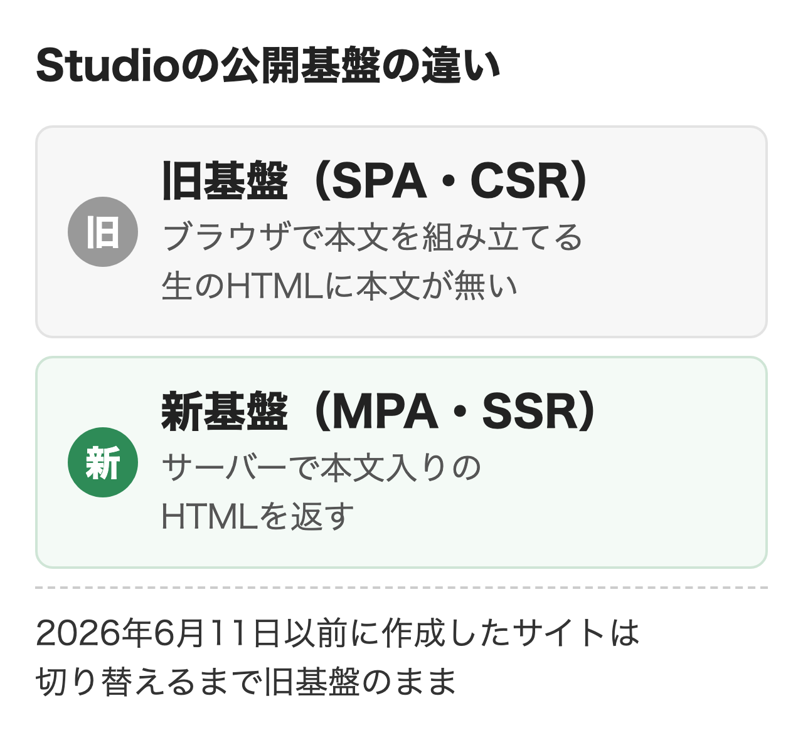
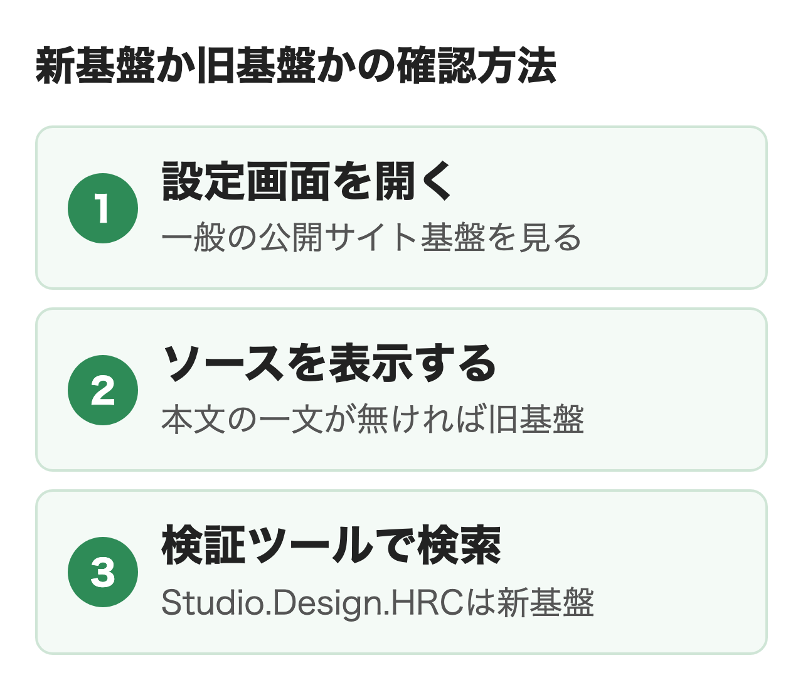
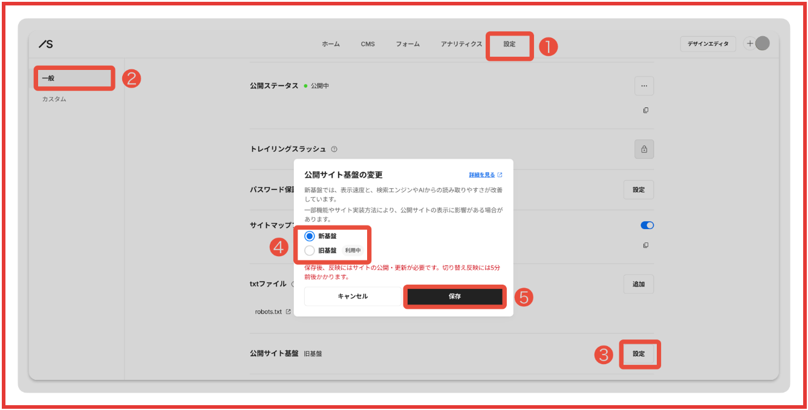
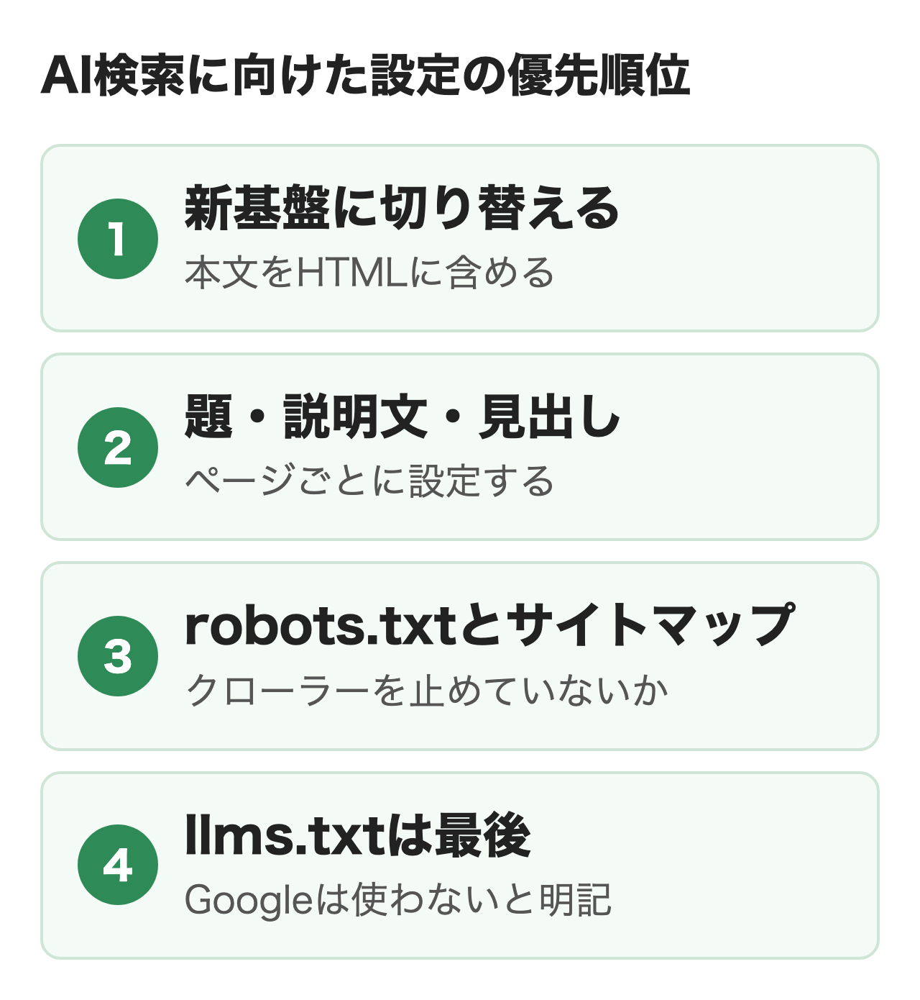

StudioのサイトはSEOに弱いわけではなく、2026年6月11日に公開基盤が刷新されてからは、本文を含んだHTMLをサーバーから返す作りになりました。ただしそれ以前に作ったサイトは切り替えるまで旧基盤のままで、ChatGPTなどJavaScriptを実行しないとされるAIには本文が届かないことがあります。

この記事では新旧の見分け方と切り替えの手順・AI検索に関わる設定・llms.txtの置き方を、Studioの公式ヘルプと実際の取得結果をもとに扱います。

:::takeaways
- **2026年6月11日以降に作ったサイトは新基盤で、本文入りのHTMLを返す**。それ以前のサイトは切り替えるまで旧基盤のまま
- **旧基盤のサイトは、最初に返されるHTMLにコンテンツが含まれない**とヘルプは説明し、nitoが取得した1サイトでも本文は0字だった。Googleは読めても、ChatGPTなどには本文が届かないことがある
- **AI検索に向けた設定は、新基盤への切り替え・題と説明文・見出し・robots.txtの順**。llms.txtはMiniプラン以上で置けるが、Googleは使わないと明記
:::

## StudioはSEOに弱い？

**検索エンジンが読むHTMLの面では、今のStudioはSEOに弱くありません。**弱いと言われてきた理由は主に4つあり、そのうち公開の仕組みに関わる1つが2026年6月に変わりました。

<figure class="post-figure"></figure>

### 弱いと言われてきた理由

制作会社やSEOの解説でよく挙がる理由は次の4つです。

- WordPressのようなプラグインが無く、機能を後から増やせない
- HTMLを直接編集できず、headに入れられるタグも限られる
- CMSで記事を大量に運用するには、公開できる数や表現に制約がある
- 旧基盤はブラウザで本文を組み立てる作りで、HTMLだけを読む相手には本文が見えにくい

上の3つは今も変わらない仕様ですが、会社やサービスを紹介する数十ページのサイトで困る場面は限られます。**4つ目は基盤の刷新で解消され、2026年6月11日以降に作ったサイトには当てはまりません。**

### 2026年6月に変わった公開の仕組み

Studioは2026年1月にベータ版として出した新しい公開サイト基盤を、6月11日に正式版にしました。旧基盤は1つのHTMLを起点にブラウザのJavaScriptで画面を組み立てるSPA（シングルページアプリケーション）で、新基盤はページごとにサーバーで完成したHTMLを作ってCDNから配信するMPA（マルチページアプリケーション）です。新基盤ではHTMLにあらかじめテキストやメタ情報を含めて出力するため、SEOとAEO（AI検索向けの最適化）の両面で有利だと公式ヘルプは説明しています。

Studioの自社検証では、テンプレートを調整したサイトのモバイルの表示速度のスコア（Lighthouse）が旧基盤の63から100に上がりました。Studio公式サイトでは、記事を扱うStudio Blogで検索から来た人の1日あたりの登録数が約84%増え、その他のページでも平均の検索順位が40位から25位に上がっています。どちらも外部要因を完全には除けておらず、すべてのサイトで同じ結果は保証しないとStudio自身が断っています。

次にやることは、自分のサイトがどちらの基盤で公開されているかの確認です。

## 新基盤か旧基盤かでAI検索の読まれ方は変わる？

**変わります。GoogleはJavaScriptを実行してから読むため差が出にくい一方、ChatGPTなどには旧基盤の本文が届かないことがあります。**ブラウザで見るとどちらの基盤も同じように表示されるため、担当者が気づきにくい差です。

### JavaScriptを実行しない取得の結果

AI検索対策を支援しているnitoが2026年11月13日に、Studioの導入事例に載っているサイトをJavaScriptを実行しない方法（curl）で取得し、生のHTMLに入っている本文を数えた結果が次の表です。

| 取得したサイト | 生のHTMLの本文 | h1の数 |
|---|---|---|
| 旧基盤のサイト | 0字 | 0 |
| 新基盤のサイトA | 約1,900字 | 1 |
| 新基盤のサイトB | 約2,500字 | 2 |

旧基盤のサイトでも、題と説明文と構造化データ（JSON-LD）は生のHTMLに入っていました。**読めるのは題と説明文までで、サービスの中身を書いた本文はHTMLに1字もありません。**GPTBot・ClaudeBot・PerplexityBot・Googlebotの名前で取得しても3サイトとも中身は同じで、本文の有無はボットの種類ではなく基盤で決まっていました。

### 旧基盤のままのサイトでAIに尋ねた例

旧基盤のままの、あるサイトについてAIに尋ねたときも、答え方が分かれました。ChatGPTはページの本文を読み取れず、GoogleのAIモードはJavaScriptの実行後の本文まで読んで答えています（nitoの実測）。Geminiは別のサイトの内容で答えましたが、GeminiはGoogleの基盤でJavaScriptまで描画するとされるため、この違いは基盤だけでは説明できません。JavaScriptを実行しないAIにとって、旧基盤のサイトから使える材料は題と説明文に限られ、サービスの内容や強みを聞かれたときに答えの根拠が不足します。

### 各社の公式と観測

OpenAI・Anthropic・Perplexityのクローラーの公式ページには、JavaScriptを実行するかどうかの記載が見当たりません。Vercelが2024年12月に公開した自社ネットワークの1か月分の観測では、3社の主なクローラーはどれもJavaScriptを実行しておらず、GeminiはGooglebotの基盤を使うためJavaScriptまで描画していました。**2年前の観測なので今も同じとは言い切れませんが、旧基盤のサイトで見た結果とは合っています。**

Googleは200を返したページをレンダリングの待ち行列に送り、JavaScriptの実行後の内容を読みます。そのGoogleも、JavaScriptを実行できないボットがあるとしてサーバー側でのレンダリングを勧めています。Studioは旧基盤では読み込みが難しかったNotebookLMなどのAIツールで、新基盤のサイトの内容を読み込めることを自社のサイトで確認したと発表しました。ただし公式ヘルプの表現は「一部のAIツール」で、すべてのAIに読まれると約束してはいません。

AI検索で社名やサービスを紹介してほしい会社は、旧基盤のままかどうかの確認を最初に行うのがおすすめです。

## 自分のサイトが新基盤か見分ける方法

**確認の方法は3つあり、2つ目と3つ目は編集の権限が無くてもブラウザだけで確認できます。**この2つは公開中のURLで行い、エディタのライブプレビューでは確認できません。

<figure class="post-figure"></figure>

### 設定画面で確認する

プロジェクトのダッシュボードで「設定」の「一般」を開くと、「公開サイト基盤」の項目があります。今の基盤の確認も切り替えも、この画面から行います。制作会社にサイトを任せていてダッシュボードに入れない場合は、次の2つの方法を使います。

### ソースを表示して本文を探す

公開中のページで右クリックして「ページのソースを表示」を選び、ページの本文から1文を選んで検索します（MacはCommand＋F、WindowsはCtrl＋F）。**本文の1文が見つかれば新基盤、題と説明文はあるのに本文が見つからなければ旧基盤の可能性が高く、確定は次の検証ツールのgeneratorで行います。**題や説明文と同じ言葉は旧基盤でも見つかるため、本文にしかない文で探すのがこつです。

JavaScriptを止めて再読み込みする方法でも同じことが分かります。Chromeなら右クリックの「検証」で検証ツールを開き、Command＋Shift＋P（WindowsはCtrl＋Shift＋P）で「Disable JavaScript」を選んでから再読み込みすると、旧基盤のページは本文が表示されません。どちらの方法も、HTMLだけを読むAIのクローラーと同じ条件で本文が読めるかを見るものです。

### 検証ツールでgeneratorを探す

公式ヘルプの手順では公開サイトのURLを開き、検証ツールの「要素」タブで「Studio.Design.HRC」を検索します。`<meta name="generator" content="Studio.Design.HRC">`があれば新基盤です。`Studio.Design`だけだったのは旧基盤のサイトで、これはヘルプの記載ではなくnitoが取得した結果です。nitoが取得した4サイト（Studio公式サイトを含む）では、この表示と生のHTMLの本文の有無は一致していました。

旧基盤だった場合は次の節の手順で切り替えます。

## 新基盤への切り替え手順と注意点

**切り替えは設定画面から数分で終わり、2027年1月末を目処に旧基盤へ戻すこともできます。**ただし事業上重要なサイト・広告やコンバージョンの計測タグを置いたサイト・アクセスの多いサイトは、テスト用のプロジェクトで新基盤の動きを確認してから本番を切り替えるよう公式が勧めています。

### 切り替えの手順

1. 今の公開サイトの表示を確認し、必要ならスクリーンショットで記録する
2. ダッシュボードの「設定」から「一般」を開き、「公開サイト基盤」の「設定」を押す
3. 「公開サイト基盤の変更」のダイアログで新基盤を選び、注意事項を読んで「保存」を押す
4. サイトを更新する（更新するまで公開サイトには反映されず、反映まで5分ほどかかる）
5. 公開サイトのURLで「Studio.Design.HRC」を確認し、もう一度サイトを更新して初回のキャッシュを作る

<figure class="post-figure"><figcaption>Studioヘルプの公開サイト基盤の切り替え手順（2026年11月13日）</figcaption></figure>

「DNSレコードが古いIPアドレスに向いています」と表示されて保存できない場合は、この手順では切り替えられません。独自ドメインを新しいIPアドレスへつなぎ直す別の手順が必要です。

### 切り替えの前に確認すること

公式ヘルプが影響の出やすい所として挙げる項目のうち、計測とSEOに関わるものが次の表です。

| 確認する所 | 新基盤で起きること | 対応 |
|---|---|---|
| Embedボックス・カスタムコード | 旧基盤のページ遷移やJavaScriptの再実行を前提にした動きが変わる | ページ遷移後も含めて動作を確認 |
| GTMやカスタムコードの独自計測 | 旧基盤向けの仮想ページビューやHistory Changeが不要になり、二重計測の原因になる | 切り替え前に設定を見直す |
| Googleアナリティクス（Apps連携） | 基本はそのまま使える | 旧基盤向けに無効にした拡張計測の項目を見直す |
| 旧「API連携（Beta）」のデータ | ページに出力されない | Data Connect API（Businessプラン以上）に移す |
| サイトタイトル・ソーシャルカバーが未設定 | 空欄のまま出力される | サイト設定で入力する |

Googleアナリティクスの拡張計測は、旧基盤では「ブラウザの履歴イベントに基づくページの変更」を無効にするよう案内されていましたが、新基盤では初期設定のまま使えます。表のほかに、URLクエリフィルター・カルーセル・モーダル内のアンカーリンクなど、表示や操作の仕様変更が合わせて8項目、公式ヘルプにまとまっています。

### 戻せる期限と旧基盤のままにする場合

切り替えたあとも、2027年1月末を目処に旧基盤へ何度でも戻して表示を確認できます。それ以降は戻す機能の提供と、旧基盤に関するサポート窓口の対応を終える予定です。

旧基盤のままでも公開は続けられ、セキュリティのアップデートも続ける予定と公式は案内しています。**ただし今後の新機能の一部は新基盤だけで提供され、旧基盤のまま更新すると意図しない不具合や表示崩れが起きる場合があります。**切り替えても、検索エンジンでの[評価に反映されるまでには時間がかかる](https://studio.design/ja/whats-new/site-speed-up-release)というのが公式の注意です。

### 制作会社に依頼するときに伝えること

サイトを制作会社に作ってもらった場合、切り替えはプロジェクトの設定を開ける側が行います。依頼するときは次の3点をまとめて伝えると、確認の往復が減ります。

- 公開サイト基盤が旧基盤か新基盤か
- 計測タグ・Embedボックス・カスタムコードの一覧と、切り替え後の動作の確認
- サイトタイトル・説明文・ソーシャルカバーが入っているか

## StudioのSEO対策で設定する項目

**AI検索に向けて見る順番は、本文がHTMLにあること・題と説明文と見出し・robots.txtとサイトマップ・llms.txtの4つです。**本文がHTMLに無い状態では、ほかの設定を整えてもAIに届くのは題と説明文までなので、基盤の確認を最初に置きます。構造化データとcanonicalは順番とは別に、この節の各項目で扱います。残りの項目は節の最後の表にまとめました。

<figure class="post-figure"></figure>

### 題と説明文

題と説明文はサイト設定とページ設定の両方で入力でき、ページ設定のほうが優先されます。モーダルには設定できません。エディタで使う「ページ名」は管理用の名前で、検索結果に出る「ページタイトル」とは別の欄です。**新基盤ではサイトタイトルが未設定だと空欄のまま出力されるため、切り替えたサイトはここを最初に見直します。**字数の目安は公式ヘルプに載っていて、書き換えたあとはサイトを更新するまで反映されません。

### 見出しタグ

文字を大きくしても、HTMLタグを指定しなければ見出しとして扱われません。テキストを選んでh1〜h6を指定し、設定できるタグはボックスの種類で決まっていて自由には書けません。CMSの記事ではタイトルとの重複を避けるため、本文の見出しをh2から始めるよう公式が案内しています。SEOのチェックツールでhタグが検出されないのは旧基盤で起こることで、JavaScriptを実行しないツールが最初のHTMLからhタグを読めないためと[公式ヘルプ](https://help.studio.design/ja/articles/9240731)は説明しています。Googleの評価には影響せず、新基盤への切り替えで解消できるという説明です。nitoが取得した新基盤の2サイトでも、生のHTMLにh1が入っていました。

### 構造化データ

構造化データ（ページの内容を検索エンジンが読める形で書いたもの）は、ページ設定の一番下の「構造化データ」でマークアップをオンにし、JSON-LDを貼って設定します。最初から既定のJSON-LDが入っていて、モーダルには設定できません。CMSの記事のような動的ページでは、タイトル・本文・カバー画像などのプロパティを差し込めるため、記事ごとに中身の違う構造化データを出せます。authorやpublisherを消す・日付の形式を誤る・全角スペースが入るといった間違いがエラーになりやすく、公式のよくあるエラーの記事に対処法があります。

一方でGoogleは、AIによる概要やAIモードに出るために特別な構造化データは不要としています。入れるなら、本文と食い違わない内容にすることが前提です。種類ごとの考え方は[構造化データはAI検索に必要？](/media/structured-data-ai-search/)で解説しています。

### サイトマップとrobots.txt

サイトマップは「設定」の「一般」にあるサイトマップをオンにすると`/sitemap.xml`に作られ、モーダルとnoindexのページは含まれません。Search Consoleへ送れるのは有料プランのプロジェクトです。

robots.txtは公開時に全プランで自動で作られ、nitoが取得した新基盤の2サイトではすべてのクローラーを許可する中身でした。自動のファイルは編集も削除もできず、AIのクローラーを個別に止めたいときはMiniプラン以上で自作のrobots.txtに置き換えます。**noindexはAIのクローラーのアクセスを制御しないと公式ヘルプに明記されているため、AIに読ませたくないページはnoindexだけでは止まりません。**

:::linkcard
url: /media/ai-crawler-robots/
title: GPTBotなどAIクローラーをrobots.txtで止めるかの判断と書き方
desc: 学習用と検索用のクローラーの違いと、robots.txtの書き方・確認の手順を解説しています。
:::

### canonicalの扱い

canonical（正規のURLの指定）は自動で付き、手動では指定できません。末尾のスラッシュの有無は新基盤のプロジェクトで選べます。canonicalはサーバー応答のHTMLには入らずブラウザでの描画時に追加される、と公式ヘルプは説明しています。**一方、nitoが取得した新基盤の2サイトでは生のHTMLにcanonicalが入っていて、旧基盤のサイトには入っていませんでした。**自分のサイトで確認するなら、ソースを表示して`rel="canonical"`を検索する方法があります。[Googleは描画のときにJavaScriptで追加されたcanonicalも取得する](https://developers.google.com/search/docs/crawling-indexing/javascript/javascript-seo-basics?hl=ja)と説明しています。Studioではcanonicalを手動で指定できないため、ソースに見つからなくても設定で直す所はありません。

### そのほかの設定項目

ここまでに挙げた以外の項目のStudioでの扱いは次の表のとおりです。

| 項目 | Studioでの扱い |
|---|---|
| 画像の代替テキスト | 画像ごとに入力。2026年10月に追加されたサイト診断で、抜けやリンク切れ・HTMLの構造のエラーをサイト全体から探せる |
| OGP画像（ソーシャルカバー） | サイト設定とページ設定で指定。新基盤では未設定だと空欄 |
| 独自ドメイン | Miniプラン以上。Freeプランは接続・公開ができない |
| 301リダイレクト | 料金ページではBusiness・Business Plusの機能例に記載。wwwあり・なしの統一は有料プラン・独自ドメインで設定 |
| Googleアナリティクス・GTM | Miniプラン以上で連携 |
| カスタムコード | 有料プラン。headに入れられるのはlink・meta・style・script・noscriptの5種類。HTMLの直接編集と書き出しはできない |
| 表示速度 | 新基盤が前提。公式のチェックリストで画像の大きさや外部スクリプトを見直す |

## llms.txtはStudioに置ける？

**置けます。Miniプラン以上の.txtアップロード機能で、サイトのルートにllms.txtを置けます。**ただし旧基盤のままなら、置くより基盤の切り替えを優先します。

プロジェクトの設定の「一般」にある.txtのアップロードの欄で「追加」を押し、ファイルを選べば置けます。上限は1ファイル1MB・30ファイルまでで、同じ名前のファイルは確認のうえ上書きされる仕様です。Freeプランでは使えません。Studio公式サイトも`/llms.txt`を置いていて、料金・ヘルプ・規約のページを正しい情報源として案内し、内容が食い違ったら公式のページを優先するよう書いています。

Googleは生成AI機能向けの最適化ガイドで、llms.txtのような特別なファイルはGoogle検索自体が使わないため作る必要はないとし、ほかのサービスのために置くのは問題ないとしています。OpenAIのクローラーの公式ページにも、llms.txtを読むという記載はありません。**旧基盤のサイトではllms.txtで案内した先のページの本文がHTMLに無いため、置く効果より基盤の切り替えが先に来ます。**

:::linkcard
url: /media/llms-txt-structured-data/
title: llms.txtとは？意味ないと言われる理由・書き方・置くかの決め方
desc: llms.txtの仕組みと公式の見解、書き方の例、置くかどうかの決め方を解説しています。
:::

## WordPressと比べてSEOで不利？

**差が出るのは公開の仕組みよりも、設定を広げる方法と記事を運用する規模です。**新基盤のStudioもページごとに本文入りのHTMLを返すため、検索エンジンやAIから見たときの基本の条件は整っています。

WordPressはSEOのプラグインで機能を増やせ、Yoast SEOやAIOSEOにはllms.txtを作る機能もあります。Wixはllms.txtをサイトごとに自動で作る仕組みです。Studioはプラグインが無い代わりに、構造化データ・サイトマップ・robots.txtの置き換え・カスタムコードを設定画面から扱います。

記事を大量に運用するなら、CMSの公開アイテム数の上限（Businessプランで5,000、Business Plusプランで15,000）と、記事の中で使える表現の幅を事前に確認しておくのがおすすめです。会社やサービス、採用を紹介する規模のサイトなら、ツールを替えるより新基盤への切り替えと基本の設定を整えるほうが早く進みます。

## まとめ

- 2026年6月11日以降に作ったサイト: 新基盤なので、題・説明文・見出しとサイトマップの設定を整える
- それ以前に作ったサイト: ソースを表示して本文が無ければ旧基盤。計測タグとカスタムコードを確認してから切り替える
- 制作会社に任せているサイト: 基盤の確認と切り替えを、計測の確認とあわせて依頼する
- llms.txtを検討しているサイト: 新基盤と基本の設定を済ませてから置く

AI検索での見え方を会社としてどう整えるかの全体の進め方は、[AIO対策とは？](/media/aio-taisaku/)で解説しています。

## よくある質問

### Q. StudioのサイトはSEOに弱いですか？

新基盤のサイトなら、検索エンジンが読むHTMLの面で弱くはありません。プラグインが無い・HTMLを直接編集できない・CMSの公開アイテム数に上限があるといった制約はあるため、記事を大量に運用するメディアでは事前に確認が必要です。

### Q. Studioの旧基盤のままだとGoogle検索に出ませんか？

出ないわけではありません。GoogleはJavaScriptを実行してから内容を読むため、旧基盤のサイトも検索に出ます。旧基盤のサイトの本文までGoogleのAIモードが読んでいた例も、nitoの実測にあります。差が出やすい相手はJavaScriptを実行しないとされるChatGPTなどのAIです。

### Q. Studioで作ったサイトが検索に出てこないときは何を確認しますか？

公開中か、ページ設定のnoindexがオンになっていないか、`site:`に続けてURLを入れて検索したときに出るかを確認します。有料プランならSearch Consoleと連携し、サイトマップを送ってインデックス登録の状況を見ます。

### Q. Studioの新基盤に切り替えると検索順位は上がりますか？

必ず上がるわけではありません。公式ヘルプも、検索エンジンがページ内容を取得しやすくなる一方で、順位は切り替え以外の要因にも左右されると説明しています。Studioの自社検証の改善の数字も、すべてのサイトでの結果は保証していません。

### Q. Studioの新基盤から旧基盤に戻せますか？

2027年1月末を目処に、何度でも戻せます。それ以降は戻す機能の提供を終える予定です。

### Q. Studioの無料プランでSEO対策はできますか？

題や説明文などの基本の設定はできますが、Freeプランは独自ドメインの接続・公開ができません。Search Consoleへのサイトマップの送信・カスタムコード・.txtのアップロードも有料プランの機能のため、会社のサイトとして検索で見つけてもらうならMiniプラン以上が前提です。

### Q. Studioでllms.txtを置くとChatGPTに引用されやすくなりますか？

引用が増えるという裏付けはありません。OpenAIのクローラーの公式ページにllms.txtを読むという記載は無く、Googleは検索で使わないと明記しています。旧基盤のサイトなら置く前に新基盤への切り替えを優先します。

### Q. StudioのサイトでAIのクローラーを止めるにはどうしますか？

Miniプラン以上で、自動で作られるrobots.txtを自作のファイルに置き換えます。ページ設定のnoindexはAIのクローラーのアクセスを制御しないため、止める手段にはなりません。

## 出典

- Studio 最新情報「[より速く、より伝わりやすく。新しい公開サイト基盤を正式リリース。](https://studio.design/ja/whats-new/site-speed-up-release)」2026年6月11日（2026年11月13日取得）
- Studio Help「[Studioの公開サイト基盤](https://help.studio.design/ja/articles/15444819)」2026年9月18日更新（同）
- Studio Help「[公開サイト基盤を旧基盤から新基盤へ切り替える](https://help.studio.design/ja/articles/13526256)」2026年9月29日更新（同）
- Studio 最新情報「[LLMやクローラー向けにサイト情報を伝える.txtファイルを管理する機能が登場](https://studio.design/ja/whats-new/txt-upload)」2026年2月9日（同）
- Studio Help「[.txtファイルをアップロードする](https://help.studio.design/ja/articles/13627103)」（同）
- Studio Help「[公開・配信の設定をする](https://help.studio.design/ja/articles/16159497)」（同）
- Studio「[料金プラン](https://studio.design/ja/pricing)」（同）
- Studio Help「[タイトルと説明文（ディスクリプション）を設定する](https://help.studio.design/ja/articles/4064972)」（同）
- Studio Help「[HTMLタグの種類と設定手順](https://help.studio.design/ja/articles/4064982)」（同）
- Studio Help「[StudioサイトをSEOチェックツールにかけると、hタグが検出されません](https://help.studio.design/ja/articles/9240731)」（同）
- Studio Help「[SEO対策](https://help.studio.design/ja/articles/2639106)」（同）
- Studio Help「[構造化データを設定する](https://help.studio.design/ja/articles/6549779)」（同）
- Studio Help「[構造化データのよくあるエラーと対処法](https://help.studio.design/ja/articles/9556108)」（同）
- Studio Help「[サイトマップファイル](https://help.studio.design/ja/articles/4581345)」（同）
- Studio Help「[ページをnoindexに設定する](https://help.studio.design/ja/articles/4258184)」（同）
- Studio Help「[canonicalタグ（URLの正規化）](https://help.studio.design/ja/articles/10030472)」（同）
- Studio Help「[サイト・ページにカスタムコードを追加する](https://help.studio.design/ja/articles/7890587)」（同）
- Studio Help「[サイト公開後、検索エンジンの検索結果にサイトやページが表示されません](https://help.studio.design/ja/articles/2248745)」（同）
- Google 検索セントラル「[AI 機能とウェブサイト](https://developers.google.com/search/docs/appearance/ai-features?hl=ja)」2025年12月31日更新（同）
- Google 検索セントラル「[Google 検索における生成 AI 機能に向けた最適化のための Google ガイド](https://developers.google.com/search/docs/fundamentals/ai-optimization-guide?hl=ja)」2026年10月30日更新（同）
- Google 検索セントラル「[JavaScript SEO の基本を理解する](https://developers.google.com/search/docs/crawling-indexing/javascript/javascript-seo-basics?hl=ja)」（同）
- OpenAI「[Overview of OpenAI Crawlers](https://developers.openai.com/api/docs/bots)」（同）
- Vercel「[The rise of the AI crawler](https://vercel.com/blog/the-rise-of-the-ai-crawler)」2024年12月17日（同）
