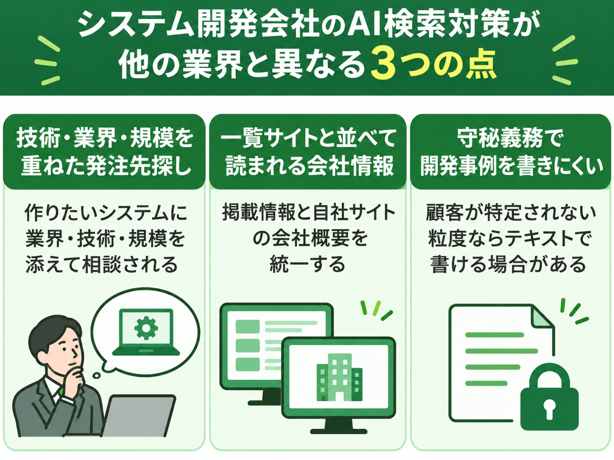
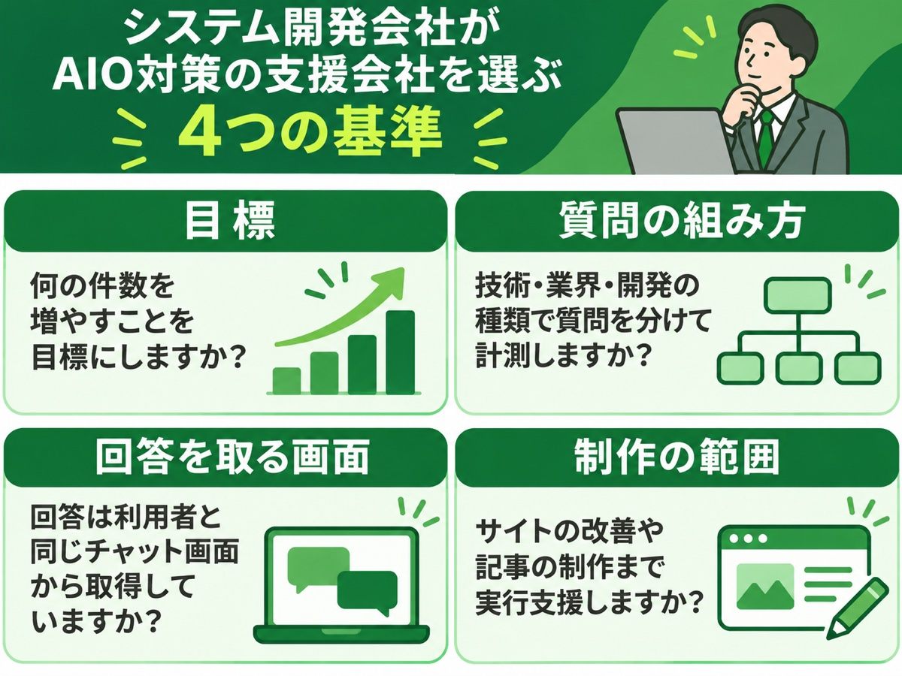

システム開発会社がAIO対策（AI検索対策）を外部に依頼するなら、**AIでの言及率より開発の相談と見積もり依頼の件数を目標に置き、分析だけで終わらずサイトの改善や記事の制作から公開後の運用まで実行支援してくれる会社**が向いています。受託開発・SIer・Web/アプリ開発会社のうち、自社サイトからの相談を増やしたい会社に合う選び方です。

この記事は株式会社nitoが書いているため、自社を1番目に載せました。ほかの6社は2026年11月17日に各社の公式サイトで確認できた内容から、どんなシステム開発会社に向いているかを書いています。

:::takeaways
- 発注側は**作りたいシステム・業界・技術・規模を1つの質問に重ねて**開発会社を聞くことがあるため、計測する質問もその組み合わせで組む
- 得意な技術・対応できる業界・開発事例・体制が**本文のテキストで書かれているか**が、AIが候補を選ぶときの材料になる
- 守秘義務で社名を出せない案件も、**業種・規模・課題・使った技術の粒度なら書ける場合がある**。公開の範囲は契約と顧客の意向で確認する
- 発注先探しの一覧サイトに載っていても、**掲載情報と自社サイトの会社概要は食い違わないように統一しておく**
- 提案は**目標・質問の組み方・回答を取る画面・制作の範囲**の4つで比べる
:::

## システム開発会社のAI検索対策が他の業界と違う点は？

発注先の探され方・一覧サイトの多さ・開発事例の書きにくさの3つで、システム開発会社は他の業界と異なります。**3つを自社に当てはめておくことが、支援会社の提案を見る前の準備です。**

<figure class="post-figure post-figure--zu"></figure>

### 技術・業界・規模を重ねた発注先探し

システム開発の発注は頻度が低く、発注側の担当者が開発会社選びに慣れていないこともあります。そうした担当者の中には作りたいシステムに業界・使いたい技術・会社の規模を添えて、頼める開発会社をAIに相談する人もいます。

| 聞き方 | AIが読みに行きやすいページ |
|---|---|
| 作りたいもので聞く（受発注と在庫をまとめて管理する業務システムを作れる会社は？） | 得意領域やサービスのページ、開発事例、発注先探しの一覧サイト |
| 業界を添える（物流業界の開発実績がある会社は？） | 業界ごとの開発事例、取引先の業種の記載 |
| 技術を添える（iOSとAndroidのアプリを1つのコードで作れる会社は？） | 技術スタックのページ、技術ブログ、事例の使用技術 |
| 進め方を添える（要件が固まっていない段階から相談できる会社は？） | 開発の進め方・契約形態・体制のページ、よくある質問 |
| 刷新を相談する（古い基幹システムをクラウドへ移行できる会社は？） | 移行の事例、保守・運用の対応範囲のページ |

**業界・業務・技術を組み合わせて得意領域を書いておくと、条件を添えた質問に答える材料がサイトにそろいます。**「あらゆる業種・技術に対応」とだけ書いたサイトでは、どの条件の質問にも当てはまる記述は多くありません。

### 一覧サイトと並べて読まれる会社情報

システム開発の発注先探しには、発注ナビや比較ビズのように、依頼したい内容から開発会社を探して見積もりを比べられるサービスがあります。発注ナビの公式サイトの案内では、登録しているシステム開発・Web制作会社などは9,000社以上です。

開発会社を探す質問ではこうした一覧サイトやおすすめ会社の比較記事が参照元に入ることもあります。自社サイトの情報が薄いと、掲載ページの短い紹介文のまま説明されることもあるでしょう。**一覧サイトの掲載情報と自社サイトの会社概要（所在地・従業員数・対応技術・取得している認証）は食い違わないように統一し、得意領域や開発事例の詳しい説明は自社で書き換えられる自社サイトに置きます。**

### 守秘義務で開発事例を書きにくい

受託開発では成果物や顧客名を契約で公開できない案件もあります。そのため実績のページが「大手製造業様 基幹システム開発」の1行だけだったり、事例を営業資料のPDFにだけ載せていたりする会社もあります。

Googleは検索のAI機能に表示されるための特別な最適化は必要ないとしており、SEOの基本の1つに挙げるのが、重要なコンテンツをテキスト形式で提示することです。**社名を出せない案件も、業種・規模・課題・使った技術・期間のように顧客が特定されない粒度なら、本文のテキストで書ける場合があります。** どこまで書けるかは秘密保持の条項と顧客の意向で決まるため、公開の前に確認が必要です。

## 支援会社はどう選べばいい？

システム開発会社が支援会社を選ぶときは、目標・質問の組み方・回答を取る画面・制作の範囲の4つを最初の打ち合わせで聞くと、各社の違いが見えてきます。

<figure class="post-figure post-figure--zu"></figure>

| 基準 | 確認する質問 | システム開発会社で重要な理由 |
|---|---|---|
| 目標 | 何の件数を増やすことを目標にしますか？ | 開発の相談・見積もり依頼・保守の相談では1件の重みが異なり、分けて数えないと費用に見合うか判断しにくい |
| 質問の組み方 | 技術・業界・開発の種類で質問を分けて計測しますか？ | 添える条件によって候補に挙がる会社が入れ替わることがある |
| 回答を取る画面 | 回答は利用者と同じチャット画面から取得していますか？ | プログラム用の窓口（API）の回答とは出典が異なることが多い |
| 制作の範囲 | サイトの改善や記事の制作まで実行支援しますか？ | エンジニアが開発で手一杯だと、提案を受けても社内で原稿を起こせないことがある |

### 開発の相談の件数を目標に置くか

言及率は途中の目印として役に立つものの、それだけで受注は増えません。技術の解説を求める質問で名前が挙がっても、聞いた人が開発を発注する段階にいるとは限らないためです。

**どの技術・業界の質問で名前が挙がれば開発の相談や見積もり依頼につながるかを先に決め、問い合わせのフォームで依頼の種類と何で知ったかまで数える会社**なら、費用に見合うかを受注の件数で判断できます。

### 技術・業界・開発の種類で質問を組むか

「おすすめのシステム開発会社」のような広い質問だけでは、条件を添えて相談されたときの見え方が分かりません。作りたいシステム・業界・技術・既存システムの刷新かどうかを1つずつ変えた質問を組むと、どの条件で他社に替わるかが見えてきます。計測を始める領域は受注の多い領域とこれから増やしたい領域から決めるのがおすすめです。

### 利用者と同じ画面で計測するか

AIの回答を集める方法には、APIから取る方式と、利用者と同じチャット画面で取る方式があります。2026年9月に公開された論文では、ChatGPTのAPIとチャット画面に同じ質問をしたとき、出典が重なったのは平均で12.0%でした。発注側の担当者が実際に目にする回答で計測しているかは、契約前に確認しておきたい点です。

### サイトの改善と記事の制作まで頼めるか

AIは会社のトップページだけでなく、得意な技術・対応できる業界・開発事例・体制など、サイトに書かれた情報を読んで候補を選びます。その情報はAIが読み取りやすい形で本文に書き起こしておく必要があります。**そのため向いているのは、分析だけで終わらず、サイトの改善や記事の制作から公開後の運用まで実行支援してくれる会社です。**

システム開発会社なら、業界と業務を組み合わせた得意領域の説明、社名を出さない形の開発事例、技術スタックと体制、契約形態と進め方が候補になります。エンジニアへのヒアリングから原稿を起こし、公開後も回答の変化を見て直し続けるのかで、依頼できる仕事の幅は大きく変わります。

## この記事での選定基準

取り上げたのはAI検索対策（AIO・LLMO・GEO）を独立したサービスとして公式サイトに載せている会社です。2026年11月17日に調べた範囲ではシステム開発会社に絞ってAIO対策を提供する会社は見つからなかったため、AIO対策会社の比較・一覧記事によく挙がる6社を選び、書き手のnitoは1番目に置きました。

紹介は公式サイトで読み取れる範囲と、どんなシステム開発会社に向いているかでまとめました。料金や契約の条件は各社の最新の案内で確認してください。

自社のSaaS製品を販売する会社向けの選び方は、[BtoB SaaS企業におすすめのAIO対策会社](/media/saas-aio-companies/)にまとめています。

## システム開発会社におすすめのAIO対策会社7社の比較

| 会社 | 強み | 向いているシステム開発会社 |
|---|---|---|
| 株式会社nito | SaaS企業の支援実績。計測からサイトの改善・記事の制作・公開後の運用まで一気通貫 | 自社サイトからの開発の相談と見積もり依頼を増やしたい会社 |
| ナイル株式会社 | SEOの長い支援実績とLLMOコンサルティング | 技術ブログやコラムが多く、SEOとまとめて依頼したい会社 |
| 株式会社LANY | SEOとLLMOのコンサルティング、記事とLPの制作 | 技術解説や開発事例の記事を中長期で増やしたい会社 |
| 株式会社Faber Company | ミエルカGEOなどのツールとGEOコンサルティング | マーケティングの担当者がツールで数字を見たい会社 |
| 株式会社ニュートラルワークス | 業界別のLLMO対策、サイト改修まで一括 | コーポレートサイトの作り直しも考えている会社 |
| 株式会社PLAN-B | SEOの土台づくり・LLMO/GEOエージェント・AI×業界の調査レポート | まず自社の業界の状況を調べたい会社 |
| 株式会社ジオコード | SEO・Web開発・AI最適化を一社で | 制作とSEOとAI検索対策を1つの窓口で依頼したい会社 |

料金はnitoを含めてどの会社も、対策の範囲や制作の量で変わります。2〜3社から見積もりを取り、4つの基準への答えを並べて比べてください。

業種を問わず依頼先を広く比べたい場合や、費用の相場を知りたい場合は、AIO対策と同じ取り組みを指すLLMO対策の会社20社を比較表で並べた記事が参考になります。

:::linkcard
url: /media/llmo-companies/
title: LLMO対策の会社おすすめ20選・比較表と費用相場・選び方
desc: LLMO対策の会社20社を比較表で並べ、費用相場と選び方を解説しています。
:::

## 1. 株式会社nito

[株式会社nito](/llmo/)は、計測から分析、サイトの改善と記事の制作、公開後の運用までを一気通貫で支援するAI検索対策の会社です。何を書き、どこを直すかは、ChatGPTやGeminiなど主要なAIの実際の回答を毎晩読み、他社が選ばれている理由から決めます。SaaS企業の支援では、AI経由のコンバージョンが5ヶ月で約6.7倍になりました。**追いかける数字は、AIでの言及率ではなく開発の相談と見積もり依頼の件数です。**

受託開発では受注した案件が納品後の保守や追加開発につながることがあります。そのため名前が挙がる質問をむやみに増やすより、自社が得意な技術と業界を添えた質問で理由つきで挙がる状態をつくることを優先します。

### システム開発会社に合う理由

- **発注側の相談の組み立てで質問を組む。** 作りたいシステム・業界・技術・既存システムの刷新かどうかを1つずつ変えた質問を設計し、受注の多い領域から順番を決める
- **実際のチャット画面で計測する。** 発注側の担当者が見る回答のまま、回答本文と引用元を毎晩記録する。これまでに記録したAIの回答は3万件を超える（2026年11月時点）
- **他社が挙がる理由を回答本文から抜き出す。** AIが他社をすすめるときに添えた理由のうち、自社にも当てはまるのにサイトに書かれていないものを、書き起こす内容の候補にする
- **得意領域と開発事例を書き起こし、公開後も直し続ける。** エンジニアへのヒアリングから得意領域・開発事例・体制の原稿を書き、既存ページの改善とあわせて公開する。公開後は回答の変化を見て書き方を修正する
- **開発の相談まで数える。** 問い合わせフォームで依頼の種類と何で知ったかを聞き、AIで知った人の相談と受注の件数まで追う

ヒアリングで自社の強みを文章にする工程から始め、お客様にお願いするのはヒアリング・公開前の確認・実装の3点だけです。

### これまでの成果

| 支援先 | 成果 |
|---|---|
| SaaS企業 | 取り組み3ヶ月で、AIでの言及率が10%から45%に。AI経由のコンバージョンは5ヶ月で約6.7倍 |
| 士業 | AIでの言及率が0%から20%に。新しいページは公開3日でAIの回答の引用元に |

成果は事業・体制・市場によって変わります。どの質問でどこまで狙えるかは、無料の現状分析のあとにお伝えしています。

### こんな会社に向いている

- 紹介や一覧サイトからの引き合いに加えて、自社サイトからの開発の相談も増やしたい受託開発・SIer・Web/アプリ開発会社
- 得意な技術や業界を添えた質問で、同業の他社の名前ばかりが挙がる会社
- 言及率のレポートより、相談と受注の件数で効果を見たい会社

:::point
nitoでは発注側の担当者が聞きそうな質問をChatGPTやGeminiなど主要なAIに実際に入力し、自社の名前が挙がるか、どう紹介されるか、代わりにどの会社が挙がるかをまとめた[現状分析レポート](/llmo/)を無料でお出ししています。
:::

## 2. ナイル株式会社

ナイル株式会社はSEOコンサルティングの長い実績を持つマーケティング支援会社です。LLMO（AI検索対策）コンサルティングをSEOのサービスと並べて提供しており、SEOとAI検索対策をまとめて依頼できます。

技術ブログやコラムがすでに多く、SEOで集めてきた記事をAI検索にも活かしたいシステム開発会社に向いています。

## 3. 株式会社LANY

株式会社LANYはSEOを中心にしたデジタルマーケティングの支援会社です。LLMOコンサルティングのほか、SEO/LLMO向けの記事制作やLP制作も扱っています。

技術解説や開発事例の記事を中長期で増やし、記事の本数もまとめて依頼したい会社に向いています。

## 4. 株式会社Faber Company

株式会社Faber CompanyはSEOツール「ミエルカSEO」で知られる会社です。AI検索での見え方を確認するツール「ミエルカGEO」と、GEO/LLMO支援のコンサルティングを提供しています。

社内にマーケティングの担当者がいて、ツールで自社の数字を見ながら改善を回したい会社に向いています。

## 5. 株式会社ニュートラルワークス

株式会社ニュートラルワークスはWeb制作と集客支援の会社です。LLMO対策（AI検索最適化対策）を扱い、SaaS・製造・建設など業界別のサービスも出しています。2026年11月17日の確認ではシステム開発会社に絞ったページは見当たりませんでしたが、Web制作の会社なのでサイトの改修までまとめて依頼できます。

コーポレートサイトが古く、AI検索対策と合わせてサイトの作り直しも考えている会社に向いています。

## 6. 株式会社PLAN-B

株式会社PLAN-BはSEOコンサルティングを長く手がけてきた会社です。2026年10月にはSEO実行支援ツール「SEARCH WRITE」を更新し、AI検索上の自社ブランドの可視化・分析から改善提案までを支援する「LLMO/GEOエージェント」の提供を始めました。生成AIが業界ごとにどの会社をすすめるかを調べた「AI×業界調査レポート」を出しており、SEOの土台づくりとあわせてAI検索の状況を調べられます。

運用を任せる前に、自社の業界でAIがどの会社をすすめているかを調べておきたい会社に向いています。

## 7. 株式会社ジオコード

株式会社ジオコードはSEO・コンテンツ・Web開発に加えて、AIO・LLMOなどのAI最適化も支援する会社です。集客から受注までを一社で完結させる体制をうたっています。

サイトの制作・SEO・AI検索対策を、窓口を分けずに一社で依頼したいシステム開発会社に向いています。

## 依頼する前に社内で整備しておくこと

どの会社に依頼する場合も、次の5つを事前に整理しておくと、最初の提案が自社の得意領域と営業の流れに合ったものになります。

1. **開発の相談と見積もり依頼の月ごとの件数と、何で知ったかの内訳。** 紹介・発注先探しの一覧サイト・展示会・自社サイトのそれぞれから何件来ているかを数え始めておくと、増えたかどうかを比べる起点になります
2. **得意領域の優先順位。** 受注の多い業界・業務・技術の組み合わせを2〜3つ選び、主力の領域と対応できる領域を分けて書けるようにしておきます
3. **開発事例の公開範囲。** 案件ごとに、社名・業種・規模・使った技術・期間のどこまでを書けるかを、秘密保持の条項と顧客の意向で確認しておきます
4. **体制と契約形態の説明。** 請負・準委任など対応できる契約の形と開発の進め方、保守・運用まで受けるかを決めておきます。IPAは発注側と開発会社の役割の解説と契約書のひな型を「情報システム・モデル取引・契約書」として公開しています
5. **1件の価値。** 平均の受注額と、保守や追加開発で取引が続く期間を出しておくと、支援にかけてよい費用の上限が見えます

[blogparts:llmo-cta]

## まとめ

- 自社サイトからの開発の相談を増やしたいなら、件数を目標に置き、計測からサイトの改善と記事の制作、公開後の運用まで実行支援する会社が向いています
- 技術ブログやコラムが多く、SEOとまとめて見直したいなら、SEOとAI検索対策を一緒に扱う会社が候補です
- コーポレートサイトが古いなら、サイトの改修まで依頼できる制作系の会社を比べるのがおすすめです
- どの会社に依頼しても、開発事例に何を書けるかは公開の前に顧客と確認してください

## よくある質問

### システム開発会社にAIO対策は必要ですか？

開発会社を探すときに、AIに相談する発注側の担当者もいます。得意な技術や業界を添えた質問で理由つきで名前が挙がるかが、自社サイトからの相談に関わります。

### AIO対策とLLMO対策は違いますか？

指す取り組みはほぼ同じで、どちらもAIの回答に自社の名前が挙がるようにすることです。GoogleのAIによる概要やAIモードを中心に言うときはAIO、ChatGPTやGeminiなどの対話型AIまで含めるときはLLMOと呼ぶことが多いです。AIO対策の呼び方で依頼先を探すなら、「[AIO対策会社おすすめ20選](/media/aio-taisaku-companies/)」が比較に使えます。

### 一覧サイトに載っていればAI検索対策は不要ですか？

一覧サイトのページが読まれても、自社の名前が理由つきで挙がるとは限りません。掲載ページの紹介文だけで説明されると得意領域や開発事例が伝わらないこともあるため、詳しい説明は自社サイトにも書いておきます。

### 守秘義務で開発事例を出せない場合はどうすればいいですか？

社名を出さずに、業種・規模・課題・使った技術・期間で書ける範囲を探すのが1つの方法です。それも難しい場合は得意領域・技術スタック・開発の進め方の説明を厚くします。新しく契約するときに社名を出さない形での事例の公開を相談しておくと、書ける事例を少しずつ増やせます。

### llms.txtやAI向けの構造化データは必要ですか？

Googleは検索のAI機能に表示されるために、AI向けのテキストファイルや特別な構造化データを新しく作る必要はないとしています。構造化データを使う場合も、ページに表示されているテキストと一致させるのが前提です。まずは得意領域や開発事例を本文のテキストで書くことを優先してください。

### 言及率が上がれば開発の相談も増えますか？

必ずしも増えません。名前が挙がる質問が技術の解説を求める人の質問ばかりなら、開発の相談にはつながりにくいからです。どの質問で挙がったかと、フォームで「AIで知った」と答えた人の数を合わせて見る必要があります。

### 自社のSaaS製品も持っている場合はどうすればいいですか？

受託開発と自社製品では相談のされ方が異なるため、ページを分けて書くのがおすすめです。受託開発は得意領域と開発事例、自社製品は機能・料金・他社製品との比較が中心になります。

### AIO対策の効果が出るまでどのくらいかかりますか？

新しいページが公開から3日でAIの回答の引用元に入った例も、3ヶ月かけて言及率が上がった例もあります。同じ領域の競合の多さと自社ページの中身で変わるため、見通しは現状を計測してから出します。

## 出典

- Google 検索セントラル「[AI 機能とウェブサイト](https://developers.google.com/search/docs/appearance/ai-features?hl=ja)」（最終更新 2025年12月31日）
- 独立行政法人情報処理推進機構（IPA）「[情報システム・モデル取引・契約書](https://www.ipa.go.jp/digital/model/index.html)」
- 発注ナビ「[公式サイト](https://hnavi.co.jp/)」・比較ビズ「[公式サイト](https://www.biz.ne.jp/)」（2026年11月17日確認）
- PLAN-B「[SEARCH WRITEのアップデート（LLMO/GEOエージェント）](https://www.plan-b.co.jp/news/search-write_update_202610/)」（2026年10月19日）
- 各社の公式サイト（2026年11月17日確認）: [ナイル株式会社](https://nyle.co.jp/)・[株式会社LANY](https://www.lany.co.jp/)・[株式会社Faber Company](https://www.fabercompany.co.jp/)・[株式会社ニュートラルワークス](https://n-works.link/)・[株式会社PLAN-B](https://www.plan-b.co.jp/)・[株式会社ジオコード](https://www.geo-code.co.jp/)
- APIとチャット画面の出典の重なり: Uberti-Bona Marin ほか「[Auditing AI-Generated Product Recommendations](https://arxiv.org/abs/2609.18729)」（arXiv、2026年9月）
